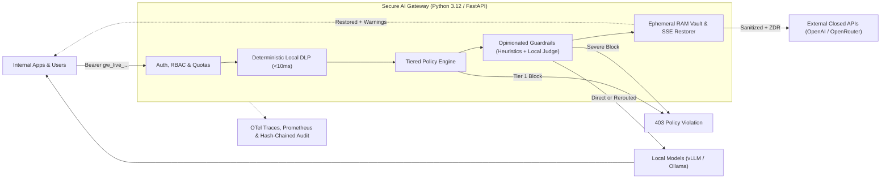

# Secure AI API Gateway

A self-contained, low-latency **Secure AI API Gateway** (`Python 3.12 / FastAPI`) for sensitive organizations—targeted for **15+ active internal users** and hosted on a **2× NVIDIA DGX Spark (`linux/arm64`) cluster**. It provides a unified OpenAI- and Anthropic-compatible API (`/v1/chat/completions`, `/v1/responses`, `/v1/embeddings`, `/v1/models`) mediating access to **OpenAI (API & Enterprise OAuth)**, **Hugging Face Paid Team Compute** (ZDR-pinned Inference Providers via `router.huggingface.co`), **OpenRouter** (Zero-Data-Retention enforced), and **locally hosted models (vLLM / Ollama)**, protected by 100% local deterministic DLP, opinionated non-deterministic local guardrails, scoped RBAC/quotas, OpenTelemetry telemetry, and tamper-evident audit logging.

## High-Level Trust Boundary

## Documentation Map

### For Humans (Product, Security & Architecture)

| Document | Audience | Contents |
| :--- | :--- | :--- |
| [Product Requirements & User Stories](docs/product/PRD_AND_USER_STORIES.md) | PM, Security, Stakeholders | Personas, Epics E1–E6, testable User Stories `US-01`–`US-16`, SLOs |
| [Visual Workflows](docs/product/VISUAL_WORKFLOWS.md) | PM, Engineering, Reviewers | End-to-end decision flow, SSE restore, reroute/block, guardrails, ops loops |
| [Market Literature Review & Competitor Analysis](docs/product/LITERATURE_REVIEW_AND_COMPETITOR_ANALYSIS.md) | PM, Leadership, Security | 5-platform 2025–2026 market review (LiteLLM, Portkey/PANW, Kong, Databricks, Credal), rubric, SWOT |
| [Competitor Feature Extraction & Gap Analysis](docs/product/FEATURE_EXTRACTION_AND_GAP_ANALYSIS.md) | PM, Architects, Security | Adopt/Adapt/Reject triage, v1.0→v2.0 gap matrix, Platform Security Invariants `#13`–`#16` |
| [Platform PRD v2.0](docs/product/PLATFORM_PRD_V2.md) | PM, Security, Engineering | Platform expansion Epics `E7`–`E14`, User Stories `US-17`–`US-36`, NFRs & SLOs |
| [Product Roadmap & RICE Prioritization](docs/product/PRODUCT_ROADMAP_AND_PRIORITIZATION.md) | PM, Leadership, SRE | RICE scoring, `v1.0`→`v2.5` phased roadmap, enterprise rollout playbook, KPIs, risk register |
| [Platform Workflows & UX Specs](docs/product/PLATFORM_WORKFLOWS_AND_UX_SPECS.md) | PM, UX, Engineering | MCP/HITL, semantic cache, monotonic routing, shadow policy, offline Console IA & APIs |
| [Proposed Architecture & Security Design](docs/architecture/PROPOSED_ARCHITECTURE.md) | Security, Architects, SRE | Trust zones, network segmentation, threat model, latency budget, ADRs |

### For Implementing Agents (Context Engineering)

| Document | Purpose | Contents |
| :--- | :--- | :--- |
| [AGENTS.md](AGENTS.md) | Root Agent Operating Manual | Reading order, target Python 3.12 toolchain, 12 hard security invariants, DoD |
| [Implementation Plan](docs/implementation/IMPLEMENTATION_PLAN.md) | Milestone Build Blueprint | Dependency DAG, complete repo tree, Milestones `M1`–`M9` with verification gates |
| [Contracts & Schemas](docs/implementation/CONTRACTS_AND_SCHEMAS.md) | Exact Technical Contracts | Python protocols/models, HTTP/header contracts, YAML blueprints, SQLite DDL, OTel/Metrics |
| [Edge Cases & Test Spec](docs/implementation/EDGE_CASES_AND_TEST_SPEC.md) | Engineering Pitfalls & Tests | SSE chunk-split state machine, checksums, anti-evasion, offline `httpx.MockTransport` spec |

## Core Capabilities at a Glance

| Capability | Design Choice | Security / Operational Benefit |
| :--- | :--- | :--- |
| **Unified Multi-Upstream API** | `/v1/chat/completions`, `/v1/responses`, `/v1/embeddings`, `/v1/models` | Drop-in compatibility for OpenAI OAuth/API, Hugging Face Paid Team Inference Providers, and local SDKs |
| **Deterministic Local DLP** | 100% local classification, secrets, code, infra/org, PII detectors | Zero raw Tier-1/PII egress; fail-closed on external detector errors |
| **Tiered Policy & Vault** | `BLOCK`, `REROUTE_LOCAL`, `REDACT`, `PSEUDONYMIZE` (RAM-only) | Balances strict egress safety with utility via reversible SSE restoration |
| **Opinionated Guardrails** | Fast local heuristics + local LLM-as-a-Judge + tool-call guard | Warns users on unauthorized actions in-band and via headers without external calls |
| **Governance & Quotas** | HMAC-SHA256 scoped keys, RBAC model allowlists, RPM & USD budgets | Least-privilege model access and predictable spend controls |
| **Maintenance Observability** | OpenTelemetry + Prometheus + SHA-256 hash-chained audit DB | Full TTFT/cost/trigger visibility with tamper detection and zero secret leakage |
