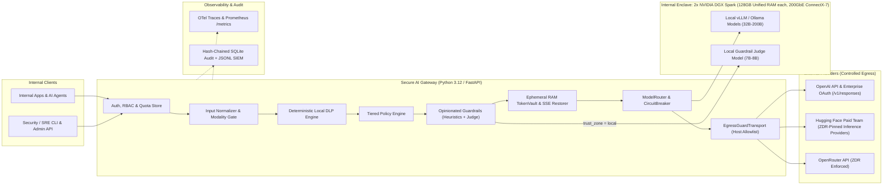
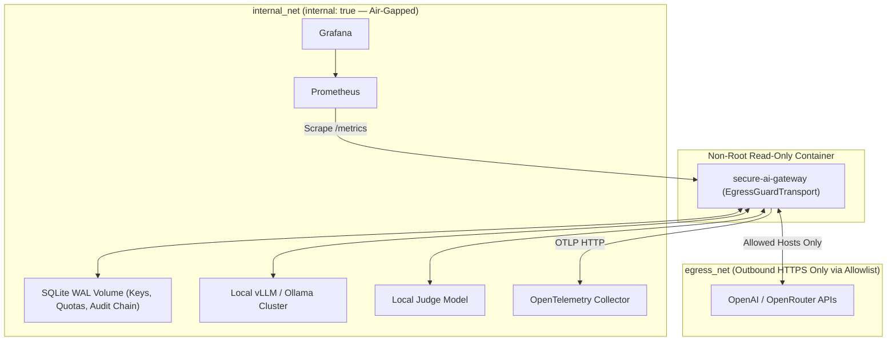

# Proposed Architecture & Security Design

## 1. System Component Architecture

The gateway enforces a strict internal trust boundary in Python 3.12 (`FastAPI` + `httpx`), isolating local inference and observability inside an internal enclave while gating external API traffic through `EgressGuardTransport`.

---

## 2. Deployment & Network Segmentation

In containerized deployments, only the hardened non-root `gateway` container bridges `internal_net` (`internal: true`, zero internet routing) and `egress_net`. Internal models, telemetry collectors, and persistent SQLite WAL storage sit strictly inside `internal_net`.

### 2.1 Target Hosting Profile: 2× NVIDIA DGX Spark Cluster (15+ Users)

The reference deployment hosts the gateway and internal enclave on **two networked NVIDIA DGX Spark nodes** serving **15+ concurrent internal users** (`1–20 RPS` typical, `50 RPS` burst), bridging high-volume external demand (**Hugging Face Paid Team compute** + **OpenAI Enterprise OAuth**) with local zero-egress enforcement:

* **Per-Node Hardware & Build Target:** NVIDIA **GB10 Grace Blackwell Superchip** (20-core Arm64 CPU + Blackwell GPU, up to 1 PetaFLOP FP4), **128 GB LPDDR5x unified memory** (`273 GB/s`), **ConnectX-7 200 Gbps** SmartNIC (forming a `256 GB` 2-node unified pool), `10 GbE` LAN, `1–4 TB` self-encrypting NVMe SSD, running **NVIDIA DGX OS (`linux/arm64` / `aarch64`)**. All container images, locked Python wheels, and optional Presidio/spaCy packages MUST target `linux/arm64`.
* **Dual-Node Role Split (Active-Active / HA):**
  * **DGX Spark Node 1 (Primary Gateway & Always-Warm Judge):** Runs `secure-ai-gateway` Replica 1, primary storage (`SQLite WAL` or PostgreSQL/Valkey primary), Prometheus/Grafana/OTel Collector, and an always-warm `7B–8B` local LLM-as-a-Judge (`~6–10 GB`, leaving `> 100 GB` RAM headroom).
  * **DGX Spark Node 2 (Secondary Gateway, Heavy Local Fallback & Embeddings):** Runs `secure-ai-gateway` Replica 2 behind a `10 GbE` VIP/Envoy reverse proxy, a local embedding model for DLP-exclusive semantic caching, and large private coding/fallback models (`32B–70B` or `200B` MoE FP4 inside `128 GB` unified memory, or `405B+` across both nodes via `200 Gbps` ConnectX-7).
* **Upstream Demand Controls:**
  * **OpenAI Enterprise OAuth & `/v1/responses`:** Brokers corporate OpenAI OAuth tokens pinned to the organization's Enterprise tenant ID (zero access/refresh token persistence) across `/v1/chat/completions` and `/v1/responses`, while **explicitly blocking personal/consumer BYOS ChatGPT OAuth accounts**.
  * **Hugging Face Paid Team Compute (`\$20/user/mo` + Compute):** Routes exclusively through **Hugging Face Inference Providers (`router.huggingface.co`)** (zero-markup pass-through to third-party hardware partners), treated strictly as `trust_zone == "external"` with full fail-closed DLP + RAM pseudonymization, a mandatory **ZDR-approved `:provider` sub-provider allowlist** (blocking unvetted `:auto`/`:fastest`/`:cheapest` routing), and local `REROUTE_LOCAL` fallback to the **2× DGX Spark** enclave for proprietary code.

---

## 3. Component Responsibility & Latency Budget

| Component | Module Path | Primary Responsibility | Latency Budget |
| :--- | :--- | :--- | :--- |
| **Auth, RBAC & Quotas** | `gateway/auth/` | HMAC-SHA256 key lookup, role/model allowlists, sliding-window RPM & daily USD/token ledger | `1–2 ms` |
| **Normalizer & Modality Gate** | `gateway/dlp/normalizer.py` | NFKC view with offset mapping, zero-width obfuscation flags, external non-text block | `< 1 ms` |
| **Deterministic Local DLP** | `gateway/dlp/` | Classification, Secrets/Entropy, Checksum PII, Infra/Org terms, Proprietary Code (+ optional offline NER) | `< 8 ms` (4KB p95) |
| **Tiered Policy & Vault** | `gateway/sanitization/` | Deterministic `BLOCK`/`REROUTE_LOCAL`/`REDACT`/`PSEUDONYMIZE`, RAM vault, SSE chunk restorer | `< 1 ms` |
| **Opinionated Guardrails** | `gateway/guardrails/` | Fast heuristics (`< 2 ms`) + local LLM-as-a-Judge + post-flight `tool_calls` guard + safe banner injector | `80–500 ms` (bound `<= 1500 ms`) |
| **Provider Router & Egress** | `gateway/providers/` | Model alias resolution, fallbacks, per-provider `CircuitBreaker`, `EgressGuardTransport`, OpenRouter ZDR | Upstream bound (`300–3000 ms` TTFT) |
| **Telemetry & Audit** | `gateway/telemetry/` | Secret-scrubbed `structlog` JSON logs, Prometheus `/metrics`, OTel spans, serialized SHA-256 audit chain | `< 2 ms` async |

---

## 4. Tiered DLP & Opinionated Guardrail Matrices

### Deterministic DLP Policy Matrix (`trust_zone == "external"`)

| Sensitivity Category | Detection Examples | Default Action | Fallback / Notes |
| :--- | :--- | :--- | :--- |
| `CLASSIFICATION` | `TOP SECRET`, `SECRET//...`, `CONFIDENTIAL`, `TLP:RED` | `BLOCK` | Hard `403` block; lower tiers configurable to `REROUTE_LOCAL` |
| `SECRET` | Vendor keys (`sk-`, `AKIA`, `ghp_`), PEM keys, JWTs, DB URIs, high entropy | `BLOCK` | Hard `403` block; zero raw bytes on logs or wire |
| `PROPRIETARY_CODE` | Org copyright headers, internal packages, large fenced code blocks | `ALLOW` | Permitted on external providers per **ADR-06** (configurable to `REROUTE_LOCAL` if policy changes); secrets/PII/infra inside code remain enforced |
| `INTERNAL_INFRA` | RFC1918/ULA IPs, `.internal`/`.corp`/`.local` hosts | `PSEUDONYMIZE` | Replaced with `[INTERNAL_IP_1]`, `[INTERNAL_HOST_1]` |
| `ORG_TERM` | Project codenames & custom dictionary from `org_terms.yaml` | `REDACT` | Irreversibly replaced with `[REDACTED_ORG_TERM]` |
| `PII` | Emails, phones, SSNs, Luhn cards, mod-11 NRIC/FIN, mod-97 IBANs, names | `PSEUDONYMIZE` | Ephemeral RAM restore in sync and streaming responses |

### Opinionated Non-Deterministic Guardrail Matrix (All Trust Zones)

| Guardrail Category | Behavioral Intent Evaluated | Default Policy | Escalation Option |
| :--- | :--- | :--- | :--- |
| `policy_evasion` | Requests to encode/obfuscate sensitive data to bypass DLP | `WARN` | `BLOCK` or `REROUTE_LOCAL` above high threshold |
| `unauthorized_security_action` | Exploitation, credential dumping, internal scanning, phishing | `WARN` / `BLOCK` | `BLOCK` at `>= 0.90` confidence |
| `unauthorized_data_exfiltration` | Instructions to extract/move internal or customer datasets externally | `WARN` / `BLOCK` | `BLOCK` at `>= 0.90` confidence |
| `unapproved_official_action` | Drafting binding legal, HR disciplinary, regulatory, or executive notices | `WARN` | Advises human sign-off via banner & headers |
| `prompt_injection_or_jailbreak` | Overrides in prompts or untrusted `role: "tool"` outputs | `WARN` | `BLOCK` at `>= 0.92` confidence |
| `risky_tool_invocation` | Post-flight destructive shell, IAM, or mass-delete `tool_calls` | `WARN` | Emits warning headers / audit alert |

---

## 5. Threat Model & Security Controls

| Threat Vector | Mitigation / Control | Enforcement Point |
| :--- | :--- | :--- |
| **Raw secret/PII egress to closed LLM** | Fail-closed local DLP + Tier-1 `BLOCK` + RAM-only `PSEUDONYMIZE` | `DetectorEngine` + `PolicyEngine` + `TokenVault` |
| **Multimodal pixel/audio DLP bypass** | External `image_url`, `input_audio`, `file` parts blocked unless role-permitted | `PayloadSanitizer` modality gate |
| **Zero-width / Unicode obfuscation** | Offset-mapped NFKC normalization + invisible character flagging | `TextNormalizer` |
| **Prompt injection against LLM judge** | Randomized per-request `<UNTRUSTED_INPUT_{nonce}>` delimiters + strict JSON parse | `LocalLLMJudge` |
| **ReDoS on Python `re` engine** | Linear-time patterns without nested quantifiers + `max_request_bytes` + timeouts | All `dlp/detectors/` + API middleware |
| **Secrets leaked into logs, spans, or DB** | `scrub_secrets_processor` + safe OTel allowlist + audit stores only counts & HMAC digests | `telemetry/logging.py`, `tracing.py`, `audit.py` |
| **Audit log tampering or row deletion** | Serialized `SHA256(prev_hash + "|" + canonical_json)` chain + `/admin/audit/verify` | `SQLiteAuditStore` (`asyncio.Lock`) |
| **External provider training / retention** | Inject `"provider": {"data_collection": "deny"}` on OpenRouter + scrub `user` ID | `OpenRouterProvider` + `PayloadSanitizer` |
| **Personal BYOS OpenAI OAuth / ZDR bypass** | Pin corporate OpenAI tenant/org ID, block consumer OAuth tokens, never persist tokens | `Auth` + `OpenAIProvider` |
| **HF Inference Providers sub-provider retention drift** | Enforce ZDR-approved `:provider` allowlist on `router.huggingface.co` and block unvetted `:auto`/`:fastest` partner routing | `HuggingFaceProvider` + `EgressGuardTransport` |
| **SSRF / unintended outbound egress** | `EgressGuardTransport` rejects any outbound host not on `allowed_egress_hosts` | `providers/base.py` |
| **Upstream outage cascading locally** | Per-provider `CircuitBreaker` (`CLOSED`/`OPEN`/`HALF_OPEN`) isolates external failures | `providers/base.py` + `ModelRouter` |

---

## 6. Architecture Decision Records (ADRs)

- **ADR-01 — Python 3.12 (`FastAPI` + `httpx`) over Go or Rust:** Upstream LLM TTFT (`300–3000 ms`) and local LLM judging (`80–500 ms`) dominate latency; Rust/Pydantic v2 and C-backed regexes keep deterministic DLP under `10 ms` (< 0.5% overhead) while enabling native Python NLP (Presidio/spaCy) without a sidecar. As validated by hyperscale Go proxies like Uber's GenAI Gateway (which uses Go goroutines for massive I/O concurrency and monorepo integration), if accreditation or traffic later demands a zero-runtime static binary at 5,000+ concurrent streams, a Go/Rust edge proxy (optionally terminating `SPIFFE/SPIRE` mTLS workload identities) can wrap this Python engine cleanly.
- **ADR-02 — Ephemeral Request-Scoped RAM `TokenVault`:** Mappings exist strictly in memory for one HTTP call and are cleared in a `finally` block. Multi-turn conversations re-pseudonymize deterministically each turn, eliminating persistent PII breach risk.
- **ADR-03 — Asymmetric Failure Semantics (DLP vs. Guardrails):** Deterministic DLP is strictly **fail-closed** for external requests (`503` or authorized `REROUTE_LOCAL`). The probabilistic local LLM judge defaults to **`fail_open_with_warning`** (heuristic fallback + `X-Gateway-Guardrail-Status: degraded`) with a **`fail_closed`** toggle for high-assurance enclaves.
- **ADR-04 — Enforced Zero-Data-Retention on OpenRouter:** All OpenRouter calls automatically append `"provider": {"data_collection": "deny"}` so upstream sub-providers cannot retain or train on sanitized traffic.
- **ADR-05 — Hash-Chained Audit Ledger Without Raw Payloads:** Audit records store `policy_version_hash`, prompt `SHA-256`, HMAC-SHA256 value digests, detection counts, guardrail verdicts, and token/cost telemetry—proving compliance and detecting tampering without becoming a secondary sensitive-data store.
- **ADR-06 — Proprietary Code Permitted on External Providers:** The organization currently does not classify `PROPRIETARY_CODE` as sensitive for external inference; therefore, `PROPRIETARY_CODE` defaults to `ALLOW` on `trust_zone == "external"` routes (with OpenRouter ZDR per **ADR-04**). Embedded `SECRET`, `CLASSIFICATION`, `PII`, `INTERNAL_INFRA`, and `ORG_TERM` findings within code remain strictly enforced, and `PROPRIETARY_CODE` detection remains available as a configurable policy toggle (`REROUTE_LOCAL` / `BLOCK`) if classification posture changes.
- **ADR-06 — Centralized Gateway Architecture over Decentralized Endpoint Classifiers (Design Consideration):** Centralizing all LLM traffic through this gateway is favored over deploying standalone classifiers on individual user devices to ensure organization-wide standardization: uniform DLP rulesets, consistent guardrail policies, immediate policy/model updates, centralized credential governance, and a unified tamper-evident audit trail without endpoint policy drift or bypasses via CLI/scripts. Because centralizing plaintext inspection increases blast radius if the gateway is compromised or misconfigured, this risk is mitigated by zero raw payload persistence (logs, spans, audit DB), ephemeral RAM-only `TokenVault`s, fail-closed DLP, and strict network segmentation (`internal_net` vs. `egress_net`); organizations may optionally layer lightweight endpoint pre-flight checks for defense-in-depth.
- **ADR-07 — vLLM Favored Over Ollama for Production Local Inference:** **vLLM** is favored over Ollama for production serving on the `2× NVIDIA DGX Spark` cluster (`15+` concurrent users, `1–20 RPS` typical / `50 RPS` burst) because it provides PagedAttention, continuous batching, native multi-node tensor/pipeline parallelism (required for `405B+` models across the `200 Gbps` ConnectX-7 link), fine-grained KV-cache/FP4 quantization control, and Prometheus `/metrics`—delivering tighter tail latency for both fallback inference and the always-warm `7B–8B` guardrail judge (`80–500 ms` budget). Because `LocalProvider` targets the standard OpenAI-compatible `/v1` API, **Ollama** remains supported for lightweight local developer/test environments (such as the `local_ollama` example in `CONTRACTS_AND_SCHEMAS.md`) without code changes.
