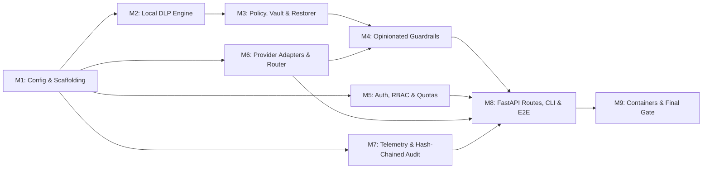

# Phased Implementation Plan (`M1`–`M9`)

Execute milestones in dependency order, running each milestone's verification command before advancing. Exact interfaces, schemas, and YAML defaults live in [CONTRACTS_AND_SCHEMAS.md](CONTRACTS_AND_SCHEMAS.md); algorithms and edge-case tests live in [EDGE_CASES_AND_TEST_SPEC.md](EDGE_CASES_AND_TEST_SPEC.md).

---

## 1. Milestone Dependency DAG



---

## 2. Target Repository File Tree

```text
gateway/
├── pyproject.toml
├── .env.example
├── Dockerfile
├── docker-compose.yml
├── README.md
├── AGENTS.md
├── config/
│   ├── gateway.yaml
│   ├── models.yaml
│   ├── policies.yaml
│   ├── guardrails.yaml
│   └── org_terms.yaml
├── deploy/
│   ├── prometheus.yml
│   └── otel-collector.yaml
├── docs/
│   ├── product/
│   │   ├── PRD_AND_USER_STORIES.md
│   │   └── VISUAL_WORKFLOWS.md
│   ├── architecture/
│   │   └── PROPOSED_ARCHITECTURE.md
│   └── implementation/
│       ├── IMPLEMENTATION_PLAN.md
│       ├── CONTRACTS_AND_SCHEMAS.md
│       └── EDGE_CASES_AND_TEST_SPEC.md
├── src/gateway/
│   ├── __init__.py
│   ├── main.py
│   ├── cli.py
│   ├── config/
│   │   ├── __init__.py
│   │   ├── settings.py
│   │   └── loader.py
│   ├── dlp/
│   │   ├── __init__.py
│   │   ├── models.py
│   │   ├── normalizer.py
│   │   ├── base.py
│   │   ├── resolver.py
│   │   └── detectors/
│   │       ├── __init__.py
│   │       ├── classification.py
│   │       ├── secrets.py
│   │       ├── pii.py
│   │       ├── infra_org.py
│   │       ├── proprietary_code.py
│   │       └── presidio_ner.py
│   ├── sanitization/
│   │   ├── __init__.py
│   │   ├── policy.py
│   │   ├── vault.py
│   │   ├── payload.py
│   │   └── stream_restorer.py
│   ├── guardrails/
│   │   ├── __init__.py
│   │   ├── models.py
│   │   ├── heuristics.py
│   │   ├── llm_judge.py
│   │   ├── tool_guard.py
│   │   ├── warning_injector.py
│   │   └── engine.py
│   ├── auth/
│   │   ├── __init__.py
│   │   ├── models.py
│   │   ├── store.py
│   │   ├── quota.py
│   │   └── dependencies.py
│   ├── providers/
│   │   ├── __init__.py
│   │   ├── base.py
│   │   ├── openai_compat.py
│   │   ├── openai.py
│   │   ├── openrouter.py
│   │   ├── local.py
│   │   └── router.py
│   ├── telemetry/
│   │   ├── __init__.py
│   │   ├── logging.py
│   │   ├── metrics.py
│   │   ├── tracing.py
│   │   └── audit.py
│   └── api/
│       ├── __init__.py
│       ├── app.py
│       ├── middleware.py
│       └── routes/
│           ├── __init__.py
│           ├── proxy.py
│           ├── admin.py
│           └── ops.py
└── tests/
    ├── conftest.py
    ├── test_detectors.py
    ├── test_policy_and_vault.py
    ├── test_guardrails.py
    ├── test_stream_restorer.py
    ├── test_auth_and_quotas.py
    ├── test_audit_chain.py
    ├── test_e2e_proxy.py
    └── test_performance.py
```

---

## 3. Milestones & Deliverables

### M1: Scaffolding & Validated Configuration
- **Dependencies:** None.
- **Files to Create:**
  - `pyproject.toml`, `.env.example`
  - `config/gateway.yaml`, `config/models.yaml`, `config/policies.yaml`, `config/guardrails.yaml`, `config/org_terms.yaml`
  - `src/gateway/__init__.py`, `src/gateway/config/__init__.py`, `src/gateway/config/settings.py`, `src/gateway/config/loader.py`
- **Key Deliverables:**
  - Pydantic v2 settings schema validating all YAML + env overrides.
  - Cross-reference startup checks: every `local_fallback_model` and `guardrails.judge_model` exists and has `trust_zone == "local"`; every external provider URL host appears in `allowed_egress_hosts`.
  - Compute canonical SHA-256 `policy_version_hash` across policies, guardrails, and org terms.
- **Verification Gate:**
  - `uv venv --python /opt/homebrew/bin/python3.12 .venv && uv pip install --python .venv/bin/python -e ".[dev]"`
  - `.venv/bin/python -c "from gateway.config.loader import load_gateway_config; cfg = load_gateway_config('config'); print(cfg.policy_version_hash)"` prints a 64-char hex digest.

### M2: Deterministic Local DLP Engine
- **Dependencies:** `M1`.
- **Files to Create:**
  - `src/gateway/dlp/{__init__,models,normalizer,base,resolver}.py`
  - `src/gateway/dlp/detectors/{__init__,classification,secrets,pii,infra_org,proprietary_code,presidio_ner}.py`
  - `tests/conftest.py`, `tests/test_detectors.py`
- **Key Deliverables:**
  - `Finding`, `SensitivityCategory`, `Severity`, `ScanResult` (no raw matched text in `repr()`).
  - `TextNormalizer` producing NFKC view with `norm_to_orig` offset table + invisible-character obfuscation detection.
  - `DetectorEngine` running enabled detectors with per-detector timeouts and `DetectorFailureError` fail-closed handling.
  - `resolve_overlaps()` sorting by `(severity desc, span_len desc, confidence desc, start asc)`.
  - 5 built-in offline detectors (`classification`, `secrets` + Shannon entropy, `pii` with Luhn/NRIC/IBAN checksums, `infra_org`, `proprietary_code`) + optional local-path `PresidioNERDetector`.
- **Verification Gate:** `.venv/bin/pytest -v tests/test_detectors.py` passes with zero failures.

### M3: Policy Engine, Ephemeral TokenVault & Stream Restorer
- **Dependencies:** `M2`.
- **Files to Create:**
  - `src/gateway/sanitization/{__init__,policy,vault,payload,stream_restorer}.py`
  - `tests/test_policy_and_vault.py`, `tests/test_stream_restorer.py`
- **Key Deliverables:**
  - `PolicyEngine` computing `PolicyDecision` (`BLOCK > REROUTE_LOCAL > REDACT > PSEUDONYMIZE > ALLOW`), handling `X-Gateway-No-Fallback: true`, and enforcing external multimodal blocking.
  - Request-scoped RAM `TokenVault` with deterministic per-request placeholder minting, restricted restore, and `clear()`.
  - `PayloadSanitizer` covering `/v1/chat/completions` (`content` str/parts, `name`, `tool_calls`, `role: "tool"`) and `/v1/embeddings` (`input`), `user` hash scrubbing, and optional placeholder preservation instruction.
  - `StreamingPlaceholderRestorer` handling arbitrary SSE splits for `delta.content` and `delta.tool_calls[].function.arguments`.
- **Verification Gate:** `.venv/bin/pytest -v tests/test_policy_and_vault.py tests/test_stream_restorer.py` passes.

### M4: Opinionated Non-Deterministic Guardrails
- **Dependencies:** `M3`, `M6` (specifically `LocalProvider` / `ModelRouter` interface for judge dispatch).
- **Files to Create:**
  - `src/gateway/guardrails/{__init__,models,heuristics,llm_judge,tool_guard,warning_injector,engine}.py`
  - `tests/test_guardrails.py`
- **Key Deliverables:**
  - `HeuristicGuardrail` (`< 2 ms`) covering evasion, jailbreak, and high-risk security phrases.
  - `LocalLLMJudge` dispatching strictly to `trust_zone == "local"` via `LocalProvider` with randomized `<UNTRUSTED_INPUT_{nonce}>` tags and noisy JSON recovery.
  - `ToolCallGuard` inspecting sync and accumulated SSE `tool_calls` for `risky_tool_invocation`.
  - `WarningInjector` emitting `X-Gateway-Guardrail-*` headers and client-safe sync/SSE markdown banners (suppressed for JSON modes, pure tool calls, embeddings, and `headers-only`).
  - `GuardrailEngine` combining heuristic + judge verdicts with `fail_open_with_warning` vs `fail_closed`.
- **Verification Gate:** `.venv/bin/pytest -v tests/test_guardrails.py` passes using mocked local judge transports.

### M5: Authentication, RBAC, Rate Limiting & Spend Quotas
- **Dependencies:** `M1`.
- **Files to Create:**
  - `src/gateway/auth/{__init__,models,store,quota,dependencies}.py`
  - `tests/test_auth_and_quotas.py`
- **Key Deliverables:**
  - `SQLiteKeyStore` storing `HMAC-SHA256(pepper, full_key)` + `hmac.compare_digest` verification, expiry, and revocation.
  - Role evaluation over `allowed_trust_zones`, globbed `allowed_models`, and `allow_multimodal_external`.
  - Sliding-window RPM limiter (`429` + `Retry-After`) and SQLite `usage_daily` token/USD quota enforcement.
- **Verification Gate:** `.venv/bin/pytest -v tests/test_auth_and_quotas.py` passes.

### M6: Provider Adapters, Egress Guard & Resilient Router
- **Dependencies:** `M1`.
- **Files to Create:**
  - `src/gateway/providers/{__init__,base,openai_compat,openai,openrouter,local,router}.py`
- **Key Deliverables:**
  - `EgressGuardTransport` wrapping `httpx.AsyncBaseTransport` to block unauthorized outbound hosts.
  - `CircuitBreaker` (`CLOSED`/`OPEN`/`HALF_OPEN`) per provider.
  - Shared `OpenAICompatProvider` with async pooling, timeouts, pre-stream retries, and `stream_options.include_usage`.
  - `OpenAIProvider`, `OpenRouterProvider` (injecting `"provider": {"data_collection": "deny"}`), `LocalProvider`, and `ModelRouter`.
- **Verification Gate:** Covered by `M4` judge tests and `M8` E2E tests (smoke import passes `mypy src`).

### M7: Telemetry, Secret-Scrubbed Logging & Hash-Chained Audit
- **Dependencies:** `M1`.
- **Files to Create:**
  - `src/gateway/telemetry/{__init__,logging,metrics,tracing,audit}.py`
  - `tests/test_audit_chain.py`
- **Key Deliverables:**
  - `structlog` JSON logger with `scrub_secrets_processor`.
  - Prometheus metrics registry (`metrics.py`) + OpenTelemetry span setup (`tracing.py`, offline no-op when OTLP endpoint unset).
  - Serialized (`asyncio.Lock`) `SQLiteAuditStore` + optional JSONL SIEM sink computing `SHA256(prev_hash + "|" + canonical_json)` and `verify_chain()`.
- **Verification Gate:** `.venv/bin/pytest -v tests/test_audit_chain.py` passes (including SQL tamper detection).

### M8: FastAPI App, Routes, CLI & End-to-End Verification
- **Dependencies:** `M4`, `M5`, `M6`, `M7`.
- **Files to Create:**
  - `src/gateway/api/{__init__,app,middleware}.py`
  - `src/gateway/api/routes/{__init__,proxy,admin,ops}.py`
  - `src/gateway/{cli,main}.py`
  - `tests/test_e2e_proxy.py`, `tests/test_performance.py`
- **Key Deliverables:**
  - `/v1/chat/completions` (sync & SSE), `/v1/embeddings`, `/v1/models` (RBAC-filtered).
  - `/admin/keys`, `/admin/audit`, `/admin/audit/verify`, `/admin/policy/dry-run`.
  - `/healthz`, `/readyz`, `/metrics`.
  - `gateway-cli` (`key create/list/revoke`, `audit verify`, `policy test`).
- **Verification Gate:** `.venv/bin/pytest -v` passes all 8 test files offline; p95 DLP + heuristic latency `< 10 ms`.

### M9: Containerization, Observability Stack & Final Static Gate
- **Dependencies:** `M8`.
- **Files to Create:**
  - `Dockerfile`, `docker-compose.yml`, `deploy/prometheus.yml`, `deploy/otel-collector.yaml`
- **Key Deliverables:**
  - Non-root read-only-FS `Dockerfile` (with optional `INSTALL_NER=true` build arg for air-gapped spaCy model baking).
  - Segmented `docker-compose.yml` (`internal_net` with `internal: true` + `egress_net` on gateway only).
- **Verification Gate:** `.venv/bin/pytest -v`, `.venv/bin/ruff check src tests`, `.venv/bin/mypy src` all exit `0`.
