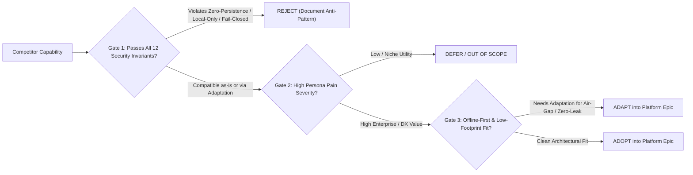

# Competitor Feature Extraction & Platform Gap Analysis

> **Purpose:** Translate findings from [LITERATURE_REVIEW_AND_COMPETITOR_ANALYSIS.md](LITERATURE_REVIEW_AND_COMPETITOR_ANALYSIS.md) into concrete, security-vetted product decisions (`ADOPT`, `ADAPT`, `REJECT`) and define the exact capability gap between the `secure-ai-gateway` v1.0 baseline ([PRD_AND_USER_STORIES.md](PRD_AND_USER_STORIES.md)) and the v2.0 platform.

---

## 1. Extraction & Triage Methodology

Every competitor capability is evaluated sequentially through three PM gates before entering the v2.0 backlog:

* **Gate 1 — Security Invariant Compatibility:** Must never violate any of the 12 Non-Negotiable Security Invariants in [AGENTS.md](../../AGENTS.md) (e.g., zero raw secret/PII persistence, fail-closed deterministic DLP, local-only LLM judge, RAM-only `TokenVault`, strict `EgressGuardTransport`).
* **Gate 2 — Persona Problem Severity:** Must materially unlock adoption for our target personas (Internal Engineer, Autonomous AI Agent, Security & Compliance Officer, Platform/SRE/FinOps Admin, Department Lead).
* **Gate 3 — Offline-First & Operational Fit:** Must run 100% air-gapped with zero phone-home, preserve `< 10 ms` p95 deterministic DLP latency, and keep single-node SQLite WAL as the zero-dependency default.

---

## 2. Competitor Feature Extraction Register (Adopt / Adapt / Reject)

### 2.1 Adopted & Adapted Capabilities (10 Strategic Capability Clusters)

| ID | Feature / Capability | Source Competitor(s) | Disposition | Target Epic | Security Invariant Impact | Extraction Rationale & Adaptation Design |
| :- | :--- | :--- | :---: | :---: | :--- | :--- |
| **F-01** | **Unified MCP Gateway & Per-Tool RBAC** | LiteLLM, Portkey, Kong (`ai-mcp-proxy`), Databricks, Credal | **ADAPT** | `E7` | Preserves #1, #2, #10; adds #15 | Expose governed `/v1/mcp/*` proxy for Streamable HTTP & SSE MCP servers with key/team/agent tool allowlists; never expose unauthenticated MCP test endpoints (preventing LiteLLM `CVE-2026-42271`). |
| **F-02** | **MCP Parameter Scoping & Pre/During/Post DLP Hooks** | Credal AI, LiteLLM, Portkey | **ADAPT** | `E7` | Preserves #1, #2, #6; adds #15 | Enforce declarative parameter constraints (e.g., max `limit`, allowed SQL schemas/paths) before dispatch, plus deterministic DLP and injection checks on both MCP arguments and tool return payloads. |
| **F-03** | **Non-Human Agent Registry & Scoped Credentials** | Credal AI, Kong (A2A), Databricks (Unity Catalog), Uber (`SPIFFE/SPIRE`) | **ADAPT** | `E7` | Preserves #9, #12; adds #15 | Register non-human agents with versioned manifests (owner, declared models, allowed MCP tools, max autonomy tier, security-review onboarding gate) and HMAC-SHA256 credentials distinct from human developer keys, with optional mTLS/`SPIFFE` workload identity verification for internal microservices. |
| **F-04** | **Human-in-the-Loop (HITL) Approval Gates** | Credal AI | **ADAPT** | `E7` | Preserves #1, #12 | Pause high-risk `tool_calls` or MCP actions (`risky_tool_invocation` / irreversible writes) via signed approval tokens and local webhook/console queue without persisting raw sensitive parameters in logs. |
| **F-05** | **Org / Team / Project Hierarchy & Cascading Budgets** | LiteLLM, Portkey, Databricks, Uber GenAI | **ADOPT** | `E8` | Preserves #9, #12 | Replace flat key-to-role mapping with `Organization -> Team -> Project -> Key/Agent` cascading RPM, TPM, and daily/monthly USD ceilings. |
| **F-06** | **Soft Budget Webhooks, Cost-Center Tags & Modality Metering** | Databricks, Kong, LiteLLM | **ADOPT** | `E8` | Preserves #1, #10 | Emit non-blocking `80%`/`90%` budget alerts via internal webhooks, accept `X-Gateway-Cost-Center` chargeback tags, and meter text, audio, image, and upstream cache read/write tokens separately. |
| **F-07** | **Pluggable OIDC / SAML SSO & Delegated Team Lifecycle** | LiteLLM (Ent.), Portkey (Ent.), Kong (Ent.) | **ADAPT** | `E8` | Preserves #9, #12 | Provide built-in offline-capable OIDC/SSO (supporting local Keycloak/Dex/ADFS in air-gaps) without gating basic SSO behind a 5-user paywall. |
| **F-08** | **Weighted Canary / A-B Traffic Splitting** | Databricks, Portkey | **ADAPT** | `E9` | Preserves #5, #8; adds #13 | Split traffic proportionally across approved models (e.g., 90% local Qwen / 10% frontier) with **Trust-Zone Monotonicity**: local-only traffic may never split or fail over to external endpoints. |
| **F-09** | **Declarative Fallback Chains & Complexity Auto-Router** | LiteLLM, Portkey, Kong | **ADAPT** | `E9` | Preserves #2, #8; adds #13 | Ordered fallback chains with per-provider circuit breakers and fast heuristic/local-classifier complexity routing—respecting `X-Gateway-No-Fallback: true` and strict trust-zone boundaries. |
| **F-10** | **OpenAI `/v1/responses` + Corporate OAuth, Hugging Face Inference Providers & `/v1/messages` Adapters** | Credal AI, LiteLLM, Portkey | **ADOPT / ADAPT** | `E9` | Preserves #1, #10, #11 | Support OpenAI `/v1/responses` + corporate OpenAI OAuth brokering (pinning org tenant ID and blocking personal BYOS), **Hugging Face Paid Team Inference Providers** (`router.huggingface.co` with ZDR-pinned `:provider` allowlists and unvetted `:auto`/`:fastest` blocking), Anthropic `/v1/messages`, and PrivateLink cloud endpoints. |
| **F-11** | **Tenant-Isolated Exact & Local Semantic Caching** | Kong, Portkey, LiteLLM | **ADAPT** | `E10` | Preserves #1, #4; adds #14 | Cache responses using local-only embedding models and tenant/role-namespaced keys—strictly **bypassing cache read and write** whenever Tier-1/2/3 DLP findings or `PSEUDONYMIZE` placeholders occur. |
| **F-12** | **Versioned Prompt Registry & Compliance Policy Decorators** | Portkey (Prompt Studio), Kong (`ai-prompt-decorator` / `template`) | **ADAPT** | `E11` | Preserves #1, #6 | Manage versioned, parameterized prompt templates and mandatory system compliance decorators in GitOps YAML/DB; never transmit unpinned raw template internals to external telemetry. |
| **F-13** | **Shadow Policy Mode & Zero-Leak User/Guardrail Feedback** | Portkey (Feedback), Databricks (Evals) | **ADAPT** | `E12` | Preserves #1, #12 | Evaluate candidate DLP/guardrail policies passively on live traffic (`shadow` ledger counts only) and provide `/v1/feedback` correlated via SHA-256 request ID (zero prompt storage) to tune false positives. |
| **F-14** | **Offline Self-Hosted Governance Console & Developer Portal** | LiteLLM (Admin UI), Portkey, Kong (Portal), Uber (Michelangelo Auto-Discovery) | **ADAPT** | `E13` | Preserves #1, #9, #12 | Serve a lightweight, zero-CDN, single-origin web UI inside the enclave for Security Officers, FinOps, and Developers (auto-discovered model catalog, self-service scoped keys with security-review gate, HITL queue, audit verifier). |
| **F-15** | **Dual-Mode Storage (SQLite Default → Postgres + Valkey HA) & Atomic Revocation** | LiteLLM (Ops lessons), Kong | **ADAPT** | `E14` | Preserves #9, #12; adds #16 | Keep zero-dependency SQLite WAL for single-node air-gaps while offering an optional PostgreSQL + Valkey/Redis backend for 2-node+ HA (such as our **2× NVIDIA DGX Spark `linux/arm64`** cluster over 200 Gbps ConnectX-7) with instant pub/sub key revocation. |
| **F-16** | **Signed Air-Gap Releases, SBOM, OTel `gen_ai.*`/`mcp.*` & Queue-Wait Metrics** | LiteLLM 2026 lessons, OTel GenAI WG | **ADOPT** | `E14` | Preserves #1; adds #16 | Ship `cosign`-signed containers + SPDX SBOMs, standardized `gen_ai.*` and `mcp.*` OTel spans (with prompt capture disabled), and ASGI pre-handler queue-wait latency gauges. |

### 2.2 Explicitly Rejected Anti-Patterns

| ID | Competitor Feature | Source Competitor(s) | Disposition | Violated Invariant / Strategic Reason |
| :- | :--- | :--- | :---: | :--- |
| **R-01** | **Persistent Raw Prompt/Response Inference Tables** | Databricks (Inference Tables), Portkey (ClickHouse logs), LiteLLM (DB spend logs) | **REJECT** | **Violates Invariant #1 (Zero Secret/PII Persistence).** Storing raw prompts/completions creates a high-value PII/secret honeypot and breaks zero-persistence compliance. |
| **R-02** | **Hybrid Cloud Control Plane / SaaS Phone-Home** | Portkey Hybrid VPC, Kong Konnect SaaS | **REJECT** | **Violates Offline-First / Air-Gap Mandate.** Outbound telemetry or control-plane sync is unacceptable in segmented or classified enclaves. |
| **R-03** | **Built-In Enterprise RAG & 50+ Data Connectors** | Credal AI | **REJECT** | **Scope Creep & Blast Radius.** Indexing Google Drive/SharePoint/Salesforce turns a stateless gateway into a massive data repository; belongs in dedicated upstream RAG services calling the gateway. |
| **R-04** | **Third-Party External Cloud Guardrail APIs** | Databricks (Partner Guardrails), Portkey, LiteLLM | **REJECT** | **Violates Invariants #2 & #5.** Sending raw user prompts to an external guardrail vendor is itself an uninspected external data egress leak. |
| **R-05** | **LLM Fine-Tuning / Training / Dataset Studio** | Databricks Mosaic AI | **REJECT** | **Explicit Non-Goal.** Training infrastructure belongs in dedicated ML platforms; the gateway remains a lean runtime control plane. |
| **R-06** | **Heavy Runtime ORM & Mandatory Multi-DB Minimum** | LiteLLM (Prisma ~500 MB/worker + mandatory Postgres/Redis) | **REJECT** | **Footprint & Resilience Risk.** Single-node and air-gapped teams need zero-dependency SQLite WAL startup; Postgres/Valkey must remain an opt-in HA scale tier. |
| **R-07** | **Compound Per-Model / Per-GB SaaS Metering** | Kong Konnect Plus | **REJECT** | **Commercial Friction.** Self-hosted governance features (SSO, audit verification, MCP proxy) will not be arbitrarily gated behind per-model fees. |

---

## 3. v1.0 → v2.0 Platform Gap Analysis Matrix

| Domain | `secure-ai-gateway` v1.0 Baseline | 2025–2026 Market Standard | Target v2.0 Platform Design | Gap Severity | Closing Epic(s) |
| :--- | :--- | :--- | :--- | :---: | :---: |
| **Agent & MCP Tool Governance** | Post-flight `tool_calls` regex warning (`US-09`) | Full MCP proxy, per-tool RBAC, param constraints, HITL gates | `/v1/mcp/*` proxy, `pre`/`post` DLP+guardrails, param schema scoping, Agent Registry, HITL queue | **Critical** | `E7` |
| **Multi-Tenancy & FinOps** | Flat key-to-role, daily key USD/token cap (`US-11`, `US-12`) | Org/Team/Project hierarchy, soft alerts, chargeback tags, OIDC | Cascading `Org -> Team -> Project -> Key/Agent` quotas, `80%`/`90%` webhooks, modality cost metering, local OIDC/SSO | **High** | `E8` |
| **Routing & Protocol Breadth** | OpenAI `/v1/chat/completions`, `/v1/embeddings`, single local fallback | Canary A/B split, fallback chains, complexity router, `/v1/responses`, `/v1/messages`, HF Inference Providers | Trust-zone-monotonic canary splits, fallback chains, heuristic auto-router, OpenAI `/v1/responses` + Enterprise OAuth, **HF Paid Team** (ZDR-pinned Inference Providers), `/v1/messages` | **High** | `E9` |
| **Caching & Cost Reduction** | None | Exact + vector semantic caching | Tenant-isolated exact & local-embedding semantic cache strictly disabled for DLP-sensitive payloads | **Medium-High** | `E10` |
| **Prompt Governance** | Optional placeholder-preservation hint | Versioned Prompt Studio, partials, mandatory system decorators | Versioned template registry + mandatory compliance decorators + GitOps YAML sync | **Medium** | `E11` |
| **Policy Tuning & Feedback** | Offline `/admin/policy/dry-run` (`US-15`) | Live shadow evaluation + user feedback correlation | Passive shadow policy mode with confusion counts + zero-leak `/v1/feedback` endpoint | **Medium** | `E12` |
| **Operator & Developer UX** | `gateway-cli` + Admin REST API | Web Admin UI + Internal Developer Portal | Self-hosted zero-CDN Governance Console + Developer Catalog & Self-Service Key Portal | **High** | `E13` |
| **HA Scale & Revocation** | Single-node SQLite WAL | Multi-replica HA with distributed rate limits | Dual-mode pluggable store (`linux/arm64` SQLite WAL default → 2-node DGX Spark Postgres + Valkey HA over ConnectX-7) + `<= 1s` revocation pub/sub | **Medium-High** | `E14` |
| **Telemetry & Supply-Chain** | Custom OTel spans, `structlog`, SHA-256 audit chain | OTel `gen_ai.*` & `mcp.*`, signed images, SBOMs, queue metrics | Full `gen_ai.*`/`mcp.*` conformance (no raw text), ASGI queue-wait metric, `cosign` + SPDX SBOM | **High** | `E14` |
| **Core DLP & Egress Safety** | 5 local detectors, RAM `TokenVault`, SSE restorer, OpenRouter ZDR | Basic Presidio / regex masking (often static) | **Market Leader (Preserved Intact)** + local VLM fallback option for multimodal requests | **None (Advantage)** | `E2`–`E3` (Retained) |

---

## 4. Proposed Platform Security Invariants Extension (`#13`–`#16`)

To ensure v2.0 platform expansion never erodes v1.0's trust posture, four new invariants extend (without modifying) Invariants `#1`–`#12` in [AGENTS.md](../../AGENTS.md):

* **Invariant #13 — Trust-Zone Monotonicity in Routing & Fallbacks:** Dynamic routing, complexity auto-routing, and fallback chains MUST preserve or tighten trust boundaries (`external -> local` is allowed; `local -> external` is strictly forbidden unless explicitly opted in by an authorized role and re-scanned from scratch by fail-closed deterministic DLP).
* **Invariant #14 — DLP-Exclusive, Tenant-Isolated Caching:** Exact and semantic caches MUST namespace keys by `(tenant_id, role_id, effective_model, policy_version_hash)` and MUST skip both cache lookup and cache insertion whenever a request triggers any Tier-1/2/3 DLP finding, `PSEUDONYMIZE` vault token, `REDACT` action, or contains restricted modalities.
* **Invariant #15 — Zero-Injection, Parameter-Scoped MCP Governance:** Every proxied MCP tool call MUST pass key/agent RBAC and declarative parameter-constraint validation before upstream execution, undergo deterministic DLP and prompt-injection checks on both arguments and tool results, and never expose unauthenticated diagnostic or test execution endpoints.
* **Invariant #16 — Verifiable Offline Supply Chain & Atomic Key Revocation:** Production releases MUST ship pinned lockfiles, reproducible container digests, cryptographic signatures, and offline SPDX SBOMs; key/agent revocation in multi-replica deployments MUST propagate atomically across all workers within `<= 1 second`.
