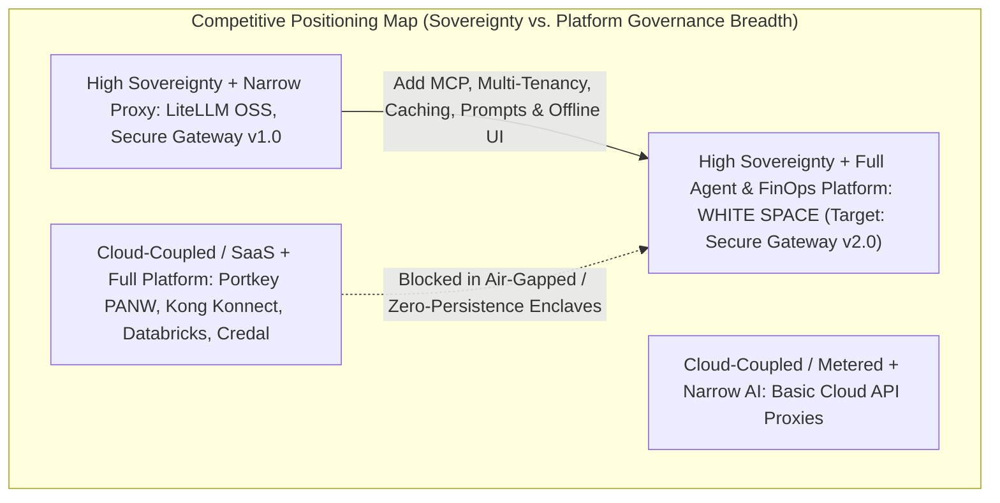

# Market Literature Review & Competitor Analysis

> **Scope & Baseline:** This analysis evaluates five leading commercial/OSS enterprise AI gateway platforms plus one production hyperscale internal reference architecture (**Uber GenAI Gateway**) in the 2024–2026 market against the `secure-ai-gateway` v1.0 baseline ([PRD_AND_USER_STORIES.md](PRD_AND_USER_STORIES.md), [PROPOSED_ARCHITECTURE.md](../../docs/architecture/PROPOSED_ARCHITECTURE.md), and [AGENTS.md](../../AGENTS.md)). Its purpose is to ground v2.0 platform product planning in verified market capabilities, architectural trade-offs, security incidents, and unserved enterprise white space.

---

## 1. Executive Summary & 2025–2026 Market Inflection Points

Between 2025 and 2026, the enterprise AI infrastructure market consolidated around **AI Gateways & Control Planes** as mandatory runtime choke points. Four structural shifts define the current landscape:

1. **Convergence of API Proxying, Runtime Security, and Agent Governance:** Gateways evolved beyond OpenAI-compatible routing to govern **Model Context Protocol (MCP)** tool servers, **Agent-to-Agent (A2A)** interactions, and post-flight tool execution alongside prompt/completion filtering.
2. **Consolidation into Security Suites (Portkey → Palo Alto Networks):** On April 30, 2026 (completed May 2026), Palo Alto Networks acquired **Portkey** and integrated its gateway into **Prisma AIRS** (AI Runtime Security). This validates runtime AI governance as a core security category while creating vendor lock-in concerns for buyers seeking neutral, self-hosted control planes.
3. **Gateway Supply-Chain & Credential-Concentration Risk (LiteLLM 2026 Incidents):** Because AI gateways centralize upstream vendor API keys and intercept every enterprise prompt, they are high-value targets. LiteLLM suffered **two PyPI/release-pipeline supply-chain compromises in 2026** (March 24, 2026 `v1.82.7`/`v1.82.8` via CI/CD dependency compromise; October 21, 2026 `v1.107.0`), alongside critical CVEs (`CVE-2026-42208` SQL injection in Bearer auth; `CVE-2026-42271` CVSS 8.7 command injection in MCP test endpoints). Air-gapped and regulated buyers now treat verifiable builds, minimal runtime footprints, and strict network segmentation as first-order buying criteria.
4. **Standardization of GenAI & Agent Telemetry:** OpenTelemetry GenAI semantic conventions (`gen_ai.*`) and native MCP telemetry attributes (`mcp.method.name`, `mcp.session.id`, `mcp.protocol.version`, `mcp.resource.uri`) became the vendor-neutral standard for tracing multi-step LLM and tool calls without persisting raw prompt payloads.

**Core Finding:** No leading market product combines **(a) 100% offline/air-gapped sovereign execution**, **(b) zero-persistence RAM-only PII pseudonymization with chunk-safe SSE restoration**, **(c) tamper-evident zero-leak hash-chained auditing**, and **(d) modern platform capabilities** (governed MCP proxy, multi-tenant FinOps, semantic caching, prompt registry, and offline governance UI). That intersection is the exact strategic white space for `secure-ai-gateway` v2.0.

---

## 2. Evaluation Framework & Weighted Rubric

To compare competitors objectively for sensitive, security-conscious engineering organizations, each platform is evaluated across 10 weighted software-product dimensions (1 = Absent / Major Liability, 3 = Partial / Paid-Only / Basic, 5 = Best-in-Class / Production-Hardened):

| # | Dimension | Weight | Evaluation Criteria |
| :- | :--- | :--- | :--- |
| 1 | **Sovereignty & Air-Gap Readiness** | `15%` | Runs 100% offline with zero phone-home; zero runtime model/rule downloads; small deployment footprint |
| 2 | **Zero-Leak DLP & Reversible Egress Safety** | `15%` | Local deterministic DLP, fail-closed external enforcement, reversible pseudonymization + SSE restoration, zero-leak logs |
| 3 | **Behavioral Guardrails & Agent/Tool Safety** | `12%` | Prompt injection defense, behavioral policy checks, post-flight `tool_calls` inspection, safe degradation |
| 4 | **MCP & Non-Human Agent Governance** | `12%` | Unified MCP proxy, per-tool RBAC, parameter scoping, agent identity registry, human-in-the-loop (HITL) approvals |
| 5 | **Multi-Provider Routing & Resilience** | `10%` | Breadth of model/protocol adapters, canary/A-B splitting, fallback chains, circuit breakers, ZDR enforcement |
| 6 | **Multi-Tenant Governance & FinOps** | `10%` | Org/Team/Project hierarchy, cascading RPM/USD budgets, chargeback tags, OIDC/SSO, modality-aware spend |
| 7 | **Latency, Caching & Footprint Efficiency** | `8%` | Sub-10 ms proxy/DLP overhead, exact & semantic caching, low RAM footprint, zero external-DB requirement for small enclaves |
| 8 | **Observability & Tamper-Evident Audit** | `8%` | OTel `gen_ai.*` / `mcp.*` traces, Prometheus metrics, zero-PII audit storage, cryptographic tamper verification |
| 9 | **Prompt Lifecycle & Policy Experimentation** | `5%` | Versioned prompt templates, policy decorators, dry-run / shadow evaluation, feedback loops |
| 10 | **Developer & Operator Experience (DX/UX)** | `5%` | OpenAI/Anthropic drop-in compatibility, CLI/GitOps, offline Admin UI & Developer Catalog, transparent pricing |

---

## 3. Detailed Literature Reviews (5 Market Platforms + 1 Internal Reference Architecture)

### 3.1 LiteLLM (Proxy & Enterprise AI Gateway)

* **Market Positioning & Architecture:** Open-source (MIT) Python/FastAPI LLM proxy with a commercial Enterprise tier. Acts as a unified OpenAI-compatible translation and governance layer across 100+ model providers, including local Ollama and vLLM endpoints.
* **Core Capabilities:**
  * *Routing & Reliability:* Load balancing across deployments, automatic retries/fallbacks, complexity-based auto-router, and sensitive-data routing to on-premise models.
  * *Caching:* Exact-match and embedding-based semantic caching via Redis, Valkey, Qdrant, S3, or GCS with per-request cache-control parameters.
  * *Guardrails & MCP:* Pre-call, post-call, and MCP hooks (`pre_mcp_call`, `during_mcp_call`, `post_mcp_call`) integrating Microsoft Presidio and third-party scanners; native MCP Gateway supporting Streamable HTTP, SSE, and stdio transports with per-key/team tool RBAC.
  * *Governance & UI:* Virtual keys, Org/Team hierarchies, spend tracking/budgets, web Admin UI, and OTel/Prometheus/Langfuse/Datadog telemetry.
* **Verified Strengths:** Broadest multi-provider adapter ecosystem (100+ providers); mature virtual-key FinOps model; early mover on native MCP gateway + MCP lifecycle guardrails in open source.
* **Verified Weaknesses & 2026 Security/Ops Risks:**
  * *Supply-Chain & CVE Exposure:* Compromised twice in 2026 (March 24, 2026 PyPI `v1.82.7`/`v1.82.8` credential-stealing malware via CI/CD Trivy breach; October 21, 2026 `v1.107.0` release pipeline compromise) plus critical 2026 vulnerabilities (`CVE-2026-42208` unauthenticated SQLi in Bearer auth; `CVE-2026-42271` CVSS 8.7 command injection in MCP test endpoints).
  * *Runtime Footprint & Infrastructure Tax:* Heavy ~500 MB RAM per worker baseline (driven in part by Prisma ORM) and mandatory PostgreSQL + Redis dependencies for virtual keys, quotas, and distributed rate limiting.
  * *Concurrency Blind Spot & Cache Drift:* ASGI event-loop saturation causes "invisible" pre-handler queue wait time not captured by internal request timers; key rotation can suffer brief cross-pod cache staleness.
  * *Enterprise Paywall:* SAML/OIDC SSO beyond 5 users, SCIM, delegated admin RBAC, and immutable audit logs require a commercial Enterprise contract.
* **Pricing & Air-Gap Topology:** MIT open-source core (\$0, zero per-token markup) + custom annual Enterprise contract. Air-gappable if paired with self-hosted Postgres + Redis and manually mirrored model pricing tables.
* **Takeaways for `secure-ai-gateway`:** Adopt LiteLLM's Org/Team/Virtual-Key FinOps hierarchy, declarative fallback/auto-routing, and MCP pre/during/post lifecycle hooks—while explicitly avoiding heavy ORMs, mandatory external DBs for baseline operation, and unverified CI/CD release pipelines.

---

### 3.2 Portkey AI Gateway (Acquired by Palo Alto Networks → Prisma AIRS)

* **Market Positioning & Architecture:** Control-plane-first AI Gateway and LLMOps platform combining a lightweight Node.js/TypeScript open-source edge proxy (`@portkey-ai/gateway`, 250–1,600+ models) with a feature-rich Enterprise control plane. Acquired by Palo Alto Networks in May 2026 (announced April 30, 2026) to power **Prisma AIRS** runtime AI security.
* **Core Capabilities:**
  * *Routing & Caching:* Weighted load balancing, conditional/canary routing, per-strategy circuit breakers, retries with exponential backoff, and native exact + semantic caching.
  * *Prompt Studio & Library:* Out-of-code prompt versioning, modular prompt partials, JSON-mode configs, and instant publishing without application redeploys.
  * *Guardrails & MCP:* Real-time PII/injection/toxicity/hallucination checks plus earliest-stage `startHooks` before auth/routing; MCP Gateway unifying OAuth/Okta/Entra ID auth with pre/post tool execution validation.
  * *Observability & Feedback:* OTel tracing with 40+ metrics, framework auto-instrumentation (LangChain, LlamaIndex, CrewAI, AutoGen), and **weighted user feedback collection** tied to requests.
* **Verified Strengths:** Fastest OSS edge proxy architecture; best-in-class Prompt Studio + modular partials; strong enterprise MCP auth unification; structured user feedback loops for measuring guardrail/model quality.
* **Verified Weaknesses & Operational Limitations:**
  * *Thin OSS Core:* The open-source `@portkey-ai/gateway` is a stateless proxy lacking RBAC, Admin UI, SCIM, semantic caching, and enterprise guardrails.
  * *Air-Gap Friction:* Hybrid VPC mode routes telemetry/config to Portkey's SaaS control plane (disqualified in air-gapped enclaves); full air-gapped VPC requires an Enterprise contract, heavy stack (PostgreSQL, ClickHouse, Redis, Kubernetes), and manual model/pricing JSON syncing.
  * *Strategic Lock-In:* Post-acquisition integration into Palo Alto Networks Prisma AIRS pulls pricing, bundling, and roadmap toward PANW's broader security suite; hosted Pro plans (~ \$49/month) impose tight log ceilings (e.g., 100K logs/month).
* **Pricing & Air-Gap Topology:** Free stateless OSS proxy; hosted Developer/Pro tiers starting ~ \$49/month with log limits; custom Enterprise contracts for private/air-gapped VPC.
* **Takeaways for `secure-ai-gateway`:** Extract Portkey's **Prompt Library/versioning**, **canary/weighted routing**, **semantic cache**, **early lifecycle hooks**, and **weighted feedback API**—delivered natively inside a single self-hosted, zero-phone-home binary/container.

---

### 3.3 Kong AI Gateway (Konnect & Kong Gateway Enterprise)

* **Market Positioning & Architecture:** Enterprise API management and multi-cloud AI/agentic gateway built as Lua plugins on Kong's OpenResty/Nginx C-core engine. Targets platform teams standardizing LLM, MCP, and API traffic on one infrastructure plane.
* **Core Capabilities:**
  * *Plugin Ecosystem:* `ai-proxy-advanced` (semantic intent routing via `pgvector` or Redis; modality-aware cost tracking across text, audio, image, video, and cache reads/writes), `ai-semantic-cache`, `ai-prompt-decorator` (injects global system/compliance instructions), `ai-prompt-template` (restricts callers to parameterized fill-in-the-blank templates), `ai-sanitizer` (inline PII scrubbing), and `ai-prompt-guard`.
  * *Agentic & MCP Governance:* `ai-mcp-proxy` bundles disparate MCP servers behind governed routes inheriting OAuth 2.0, OIDC, token exchange, and rate limits; **Agent-to-Agent (A2A)** governance issues cryptographic agent credentials and end-to-end audits.
  * *Developer Portal:* Self-service catalog and credential portal built on Kong Konnect.
* **Verified Strengths:** Ultra-low-overhead C-core/Nginx data plane; standout `ai-prompt-decorator` and `ai-prompt-template` governance primitives; clean mapping of OAuth2/OIDC enterprise auth to MCP tools; modality-granular token accounting.
* **Verified Weaknesses & Operational Limitations:**
  * *Narrower Native Provider Coverage:* Roughly 15+ major providers natively compared to 100+ in LiteLLM or 250+ in Portkey.
  * *Paywalled AI Surface & Compound Metering:* Kong OSS lacks semantic cache, semantic routing, PII sanitizer, prompt guard, MCP proxy, audit logs, and SSO. Konnect Plus adds compound multi-dimensional pricing (\$25–\$500/month control planes, ~ \$100/month per AI model proxy, \$0.15/GB bandwidth, 10M request/month cap) that pushes scaling teams into \$30,000–\$50,000+/year Enterprise contracts.
  * *Stack Complexity:* Operating Kong Enterprise + OpenResty/Lua + PostgreSQL strictly air-gapped carries higher platform-engineering overhead than a focused Python/FastAPI service.
* **Pricing & Air-Gap Topology:** Apache 2.0 OSS (thin AI features); metered Konnect Plus SaaS/hybrid; custom annual Enterprise contracts for air-gapped self-hosting.
* **Takeaways for `secure-ai-gateway`:** Adopt Kong's **`ai-prompt-decorator`** (mandatory system compliance headers), **`ai-prompt-template`** (parameterized safe templates), **modality-aware cost metering**, and **Developer Portal** concepts without compound per-model/per-GB pricing gates.

---

### 3.4 Databricks Mosaic AI Gateway (Unity AI Gateway)

* **Market Positioning & Architecture:** Lakehouse-native AI governance and serving plane deeply embedded in Databricks and **Unity Catalog**. Governs models, MCP services, tool functions, vector indexes, and inference logs as unified data-governance assets.
* **Core Capabilities:**
  * *Unity Catalog Securables:* Models, MCP endpoints, and tools inherit Unity Catalog RBAC for both human users and non-human agent identities, alongside data lineage and tags.
  * *Traffic Splitting & Routing:* Proportional A/B traffic splitting (e.g., 90% open-weight / 10% frontier), multi-cloud failovers (AWS Bedrock / Azure / internal), and smart cost-quality routing.
  * *FinOps & Guardrails:* Token/request rate limits, hard/soft spend caps, built-in PII/PHI masking, content safety service policies, and external third-party guardrail hooks.
  * *Inference Tables & System Schemas:* Automated Delta-table logging (`system.ai`, `system.serving`) feeding drift detection, cost attribution, and evaluation pipelines.
* **Verified Strengths:** Unified governance across human and non-human agent identities; crisp A/B traffic splitting and multi-cloud failover; clear separation of soft alerts vs. hard budget caps.
* **Verified Weaknesses & Operational Limitations:**
  * *Total Platform Lock-In:* Coupled to the Databricks control plane and Unity Catalog; unsuitable as a lightweight, standalone, or air-gapped on-premise microservice proxy.
  * *Raw Payload Persistence Risk:* Inference Tables persist full prompts and responses in Delta storage by default (creating a secondary PII/secret honeypot prohibited under strict zero-persistence policies) and incur payload logging charges (~ \$0.10/GB) on top of DBU compute tiers.
* **Pricing & Air-Gap Topology:** DBU consumption billing (Premium/Enterprise tiers) plus payload logging fees and pass-through upstream inference costs. Cannot operate standalone outside Databricks cloud workspaces.
* **Takeaways for `secure-ai-gateway`:** Extract **proportional A/B/canary traffic splitting**, **first-class non-human agent principals**, and **soft-threshold vs. hard-cap budget controls**—while strictly rejecting persistent raw Inference Tables in favor of our zero-leak hash-chained audit ledger.

---

### 3.5 Credal AI

* **Market Positioning & Architecture:** Security-first enterprise AI platform and agent/MCP control plane targeting regulated industries (SOC 2 Type II, GDPR, CCPA, HIPAA). Combines an LLM gateway with permission-aware RAG and strict agent tool governance.
* **Core Capabilities:**
  * *Permission Mirroring & Secure RAG:* Mirrors source-system ACLs (Google Drive, SharePoint, Salesforce, Confluence, Slack) in real time across 50+ connectors so users and agents only retrieve documents they are already permitted to see.
  * *Self-Hosted DLP & Department Policies:* Self-hosted PII/PHI/PCI detection with redact, mask, warn, or block actions plus department-level acceptable-use rules.
  * *Governed MCP & Agent Registry:* Turns internal workflows into department-scoped MCP servers with **enforced parameter constraints** (e.g., fixed filters, row limits), **Human-in-the-Loop (HITL) approval gates** for high-stakes actions, and a centralized **Agent Registry** with versioning, rollbacks, and tool-call audit trails.
* **Verified Strengths:** Industry-leading **MCP parameter scoping** and **HITL approval workflows** for risky agent actions; explicit **Agent Registry** lifecycle management; dual OpenAI + Anthropic backwards-compatible gateway.
* **Verified Weaknesses & Operational Limitations:**
  * *Opaque Procurement & No Self-Serve OSS:* Sales-led custom Enterprise contracts only; no open-source core or self-serve sandbox for engineering evaluation.
  * *Broad Data Surface Area:* Operating 50+ enterprise RAG connectors and search indexes expands the platform's persistent data footprint—contrasting sharply with a stateless, zero-persistence security gateway.
* **Pricing & Air-Gap Topology:** Custom annual enterprise contracts (seat, agent, and connector scope). Self-hosted/VPC options negotiated via enterprise sales.
* **Takeaways for `secure-ai-gateway`:** Adopt Credal's **MCP parameter constraints** (row limits, allowed schemas), **HITL approval gates** for high-risk tool executions, **Agent Registry with manifests/versioning**, and **Anthropic `/v1/messages` compatibility**—while rejecting persistent enterprise RAG document indexing to preserve zero-persistence security.

---

### 3.6 Uber GenAI Gateway (Internal Enterprise Reference Architecture)

* **Market Positioning & Architecture:** Proprietary, high-performance **Go-based** LLM serving proxy built by Uber Engineering (published July 2024, integrated with Uber's **Michelangelo** ML platform). Built to eliminate fragmented, per-team LLM integrations across 60+ internal use cases (customer support automation, chat summarization, SQL generation, Uber Eats recommendations) by centralizing traffic to third-party vendors (OpenAI, Google Vertex AI) and Uber-hosted fine-tuned open-source models (Llama, Mixtral).
* **Core Capabilities:**
  * *OpenAI API Schema Mirroring:* Mirrors OpenAI's standard HTTP/JSON interface so internal apps and open-source frameworks (LangChain, LlamaIndex) work out of the box and backend models can be swapped without client code changes.
  * *Synchronous PII Redaction & Security Gate:* Automatically detects and strips/redacts 20+ types of PII synchronously before prompts leave Uber's network perimeter; pairs with a mandatory Engineering Security review gate before onboarding new use cases.
  * *Zero-Trust Workload Identity:* Authenticates internal calling services using cryptographic workload identities (**SPIFFE/SPIRE**) rather than relying solely on static long-lived API keys.
  * *Control-Plane Auto-Discovery & FinOps:* Integrates with Michelangelo's Control Plane to dynamically discover and catalog model endpoints, while enforcing per-team rate limits, budget caps, chargebacks, request caching, load balancing, and end-to-end token/latency/audit telemetry.
* **Verified Strengths:** Low-latency, high-concurrency Go proxy architecture (goroutines) well-suited to massive network I/O and SSE streaming; seamless OpenAI-compatible developer onboarding; strong internal zero-trust identity (SPIFFE/SPIRE) and pre-onboarding security review discipline; dynamic model endpoint discovery.
* **Verified Weaknesses & Operational Limitations:**
  * *Not Available as an Off-the-Shelf Product:* Proprietary internal service tightly coupled to Uber's Go monorepo, Michelangelo ML platform, and internal service mesh—unusable directly by external or air-gapped teams without rebuilding the platform.
  * *Static PII Redaction Only:* Strips/redacts PII before external egress rather than performing reversible RAM-only pseudonymization with SSE chunk restoration, which can degrade downstream reasoning quality when entity consistency matters.
  * *Split Model vs. Tool Control Plane:* Originally built as a Model Gateway, requiring a separate **MCP Gateway** layer later to govern agent-to-tool permissions rather than unifying LLM and MCP governance in a single policy engine.
* **Pricing & Air-Gap Topology:** Internal bespoke engineering build (not commercially licensed). Operates inside Uber's private infrastructure with controlled external egress to approved vendor APIs.
* **Takeaways for `secure-ai-gateway`:** Validates our **OpenAI API mirroring** and **synchronous pre-egress DLP** design; highlights **SPIFFE/SPIRE zero-trust workload identity** (for internal service-to-gateway auth), **control-plane model endpoint auto-discovery**, and **mandatory security onboarding gates** as high-value patterns; and reinforces our **ADR-01** option to place a Go/Rust edge proxy in front of our Python DLP engine if concurrency ever scales past 5,000+ simultaneous streams.

---

## 4. Comprehensive Competitive Feature & Rubric Comparison

### 4.1 Capability Comparison Matrix

| Capability | LiteLLM Proxy | Portkey (PANW Prisma AIRS) | Kong AI Gateway | Databricks Mosaic AI | Credal AI | Uber GenAI Gateway *(Internal Ref.)* | `secure-ai-gateway` v1.0 (Baseline) | `secure-ai-gateway` v2.0 (Target) |
| :--- | :--- | :--- | :--- | :--- | :--- | :--- | :--- | :--- |
| **Deployment Model** | Self-hosted OSS / Enterprise | SaaS / Hybrid / Ent. Air-Gap | SaaS Konnect / Ent. Self-Host | Cloud Lakehouse (Managed) | Ent. SaaS / Private VPC | Internal Go Service (Michelangelo) | 100% Offline Container | 100% Offline Container + HA Option |
| **Air-Gap Readiness (Zero Phone-Home)** | High (needs Postgres + Redis) | Paid Ent. only (Hybrid phones home) | Paid Ent. only (Lua + Postgres) | None (Cloud-coupled) | Enterprise-negotiated | Internal Infra (Monorepo-coupled) | **Best-in-Class** (SQLite WAL, zero egress) | **Best-in-Class** (SQLite default, optional HA) |
| **Zero-Persistence Audit (No Raw Prompts)** | Opt-out logging (DB stores logs) | Logs persisted in ClickHouse | Configurable / SIEM | Inference Tables store raw text | Audit logs store prompts/tools | Internal audit logs | **Hard Invariant** (Counts + HMAC + SHA-256 chain) | **Hard Invariant** (Tamper-evident zero-leak) |
| **Deterministic Local DLP (<10 ms)** | Presidio plugin (heavier) | Built-in + regex (Ent. focus) | `ai-sanitizer` (Paid Ent.) | Built-in PII/PHI (Cloud) | Self-hosted DLP | Sync PII redactor (20+ types) | **5 Built-in Offline Detectors + Checksums** | **5 Built-in + Optional Local NER** |
| **Reversible Pseudonymization + SSE Restore** | No (static masking) | Partial / static masking | Static redaction | Static masking | Mask / redact | No (static PII redaction) | **Yes (RAM TokenVault + Chunk-Safe SSE)** | **Yes (RAM TokenVault + Chunk-Safe SSE)** |
| **Local-Only LLM Guardrail Judge + Nonce** | External/custom guardrails | Cloud/custom guardrails | Custom / NeMo plugin | Cloud/partner guardrails | Self-hosted models | Security review gate + guardrails | **Yes (Local-only + Randomized Nonce)** | **Yes (Local-only + Nonce + Shadow Eval)** |
| **External Modality Gate (Image/Audio/File)** | Pass-through | Pass-through | Modality cost tracking | Pass-through | File connectors | Policy-gated | **Hard 403 Gate unless RBAC-allowed** | **Hard 403 Gate + Local VLM Reroute** |
| **OpenRouter ZDR (`data_collection: deny`)** | Manual param | Manual param | Manual param | N/A | N/A | N/A (Direct vendor contracts) | **Enforced by Default** | **Enforced Across External Adapters** |
| **Provider & Protocol Breadth** | 100+ providers | 250–1,600+ models | ~15+ providers | Databricks + major clouds | OpenAI + Anthropic | OpenAI, Vertex AI, in-house Llama/Mixtral | OpenAI, OpenRouter, Ollama/vLLM | + Anthropic `/v1/messages`, Private VPC Clouds |
| **Canary / A-B Split & Fallback Chains** | Yes (Load balance + fallback) | Yes (Weighted + circuit breaker) | Yes (`ai-proxy-advanced`) | Yes (Proportional A/B) | Basic routing | Load balancing + endpoint discovery | Single local fallback | **Trust-Zone-Monotonic Canary & Fallbacks** |
| **Exact & Semantic Caching** | Yes (Redis/Valkey/Qdrant) | Yes (Native Semantic, Paid) | Yes (Paid Ent. plugin) | Prompt cache pass-through | No | Request caching | None | **Tenant-Isolated & DLP-Exclusive Cache** |
| **Governed MCP Gateway & Tool RBAC** | Yes (Pre/During/Post hooks) | Yes (OAuth + Pre/Post hooks) | Yes (`ai-mcp-proxy`, Paid) | Yes (Unity Catalog MCP) | Yes (Param scoping) | Separate MCP Gateway layer | Post-flight `tool_calls` warn | **Full MCP Proxy, Param Scoping & DLP Hooks** |
| **Agent Identity Registry & HITL Gates** | Virtual keys only | Trace correlation | A2A crypto credentials | Non-human UC principals | **Agent Registry + HITL** | **SPIFFE/SPIRE** workload identity | API Key roles only | **Agent Registry + HITL Approval Queue** |
| **Multi-Tenant Hierarchy (Org/Team/Project)** | **Yes (Org/Team/Key)** | Yes (Workspaces, Ent.) | Consumer Groups | Unity Catalog workspaces | Departments | Team / use-case quotas & chargeback | Flat key-to-role | **Org / Team / Project + Chargeback Tags** |
| **Prompt Registry & Policy Decorators** | Prompt pass-through | **Prompt Studio & Partials** | **Decorator + Template plugins** | Prompt registry (MLflow) | App-level prompts | App-level / internal | Optional placeholder hint | **Versioned Templates + Policy Decorators** |
| **Policy Dry-Run & Shadow Evaluation** | Basic testing | Playground / Evals | No native shadow mode | MLflow evaluation | Policy testing | Security review gate | `/admin/policy/dry-run` | **Live Shadow Policy Mode + Feedback API** |
| **Admin Governance UI & Dev Portal** | Yes (Web Admin UI) | Yes (SaaS / Ent. UI) | Konnect Portal (Paid) | Databricks UI | Enterprise Portal | Michelangelo Control Plane | CLI + Admin REST API | **100% Offline Governance Console & Portal** |
| **OTel GenAI (`gen_ai.*`) & MCP (`mcp.*`)** | OTel export | OTel export | OTel plugin | System tables | Audit export | Internal Uber telemetry | Custom OTel spans | **Full `gen_ai.*` / `mcp.*` + Queue-Wait** |
| **Supply-Chain & Zero-Dep Simplicity** | 2026 PyPI/CVE incidents; ~500MB RAM | Clean edge, heavy Ent. stack | Clean C-core, complex Ops | Managed service | Managed / Ent. VPC | Go binary (internal monorepo) | Minimal Python 3.12 + SQLite | **Signed Releases + SBOM + SQLite/HA** |

### 4.2 Weighted Rubric Scorecard (1–5 Scale)

| Dimension | Weight | LiteLLM | Portkey | Kong AI | Databricks | Credal AI | Uber GenAI | `secure-ai-gateway` v1.0 | `secure-ai-gateway` v2.0 |
| :--- | :---: | :---: | :---: | :---: | :---: | :---: | :---: | :---: | :---: |
| 1. Sovereignty & Air-Gap Readiness | 15% | 3.5 | 2.5 | 3.0 | 1.0 | 2.5 | 3.5 | **5.0** | **5.0** |
| 2. Zero-Leak DLP & Reversible Egress | 15% | 2.5 | 3.0 | 3.0 | 2.5 | 3.5 | 3.5 | **5.0** | **5.0** |
| 3. Behavioral Guardrails & Tool Safety | 12% | 3.0 | 4.0 | 3.5 | 3.5 | 4.0 | 3.5 | **4.5** | **5.0** |
| 4. MCP & Non-Human Agent Governance | 12% | 4.0 | 4.0 | 4.0 | 4.0 | **5.0** | 3.5 | 1.5 | **4.8** |
| 5. Multi-Provider Routing & Resilience | 10% | **5.0** | **5.0** | 4.0 | 4.0 | 2.5 | 4.0 | 2.5 | **4.5** |
| 6. Multi-Tenant Governance & FinOps | 10% | **4.5** | 4.0 | 3.5 | **4.5** | 3.5 | **4.5** | 2.5 | **4.5** |
| 7. Latency, Caching & Footprint | 8% | 2.5 | 4.5 | **4.5** | 3.5 | 3.0 | **4.5** | 4.0 | **4.5** |
| 8. Observability & Tamper-Evident Audit | 8% | 3.5 | 4.0 | 3.5 | 4.0 | 3.5 | 4.0 | 4.5 | **5.0** |
| 9. Prompt Lifecycle & Policy Shadowing | 5% | 2.0 | **5.0** | 4.0 | 3.5 | 2.5 | 2.5 | 2.5 | **4.5** |
| 10. DX / Operator UX & Transparent Cost | 5% | 4.0 | 3.5 | 2.5 | 3.0 | 2.5 | 3.5 | 3.0 | **4.5** |
| **Weighted Total Score (Max 5.00)** | **100%** | **3.46** | **3.79** | **3.51** | **3.10** | **3.37** | **3.72** | **3.64** | **4.79** |

---

## 5. Market Positioning & White-Space Strategy

The market clusters into three crowded corners plus bespoke internal builds: **(1) Lightweight/OSS Proxies** (LiteLLM OSS, Portkey OSS) that lack deep zero-leak DLP and enterprise compliance; **(2) Cloud-Coupled Control Planes** (Portkey Enterprise/PANW, Databricks Unity, Credal) that assume cloud telemetry, SaaS control planes, or raw payload persistence; **(3) Legacy API Gateways** (Kong) that bolt AI plugins onto metered enterprise licensing; and **(4) Bespoke Hyperscaler Internal Gateways** (Uber GenAI Gateway) that require a dedicated Go monorepo, ML control plane (Michelangelo), and service-mesh stack (SPIFFE/SPIRE).

### The Unowned White Space: *"The Sovereign, Zero-Persistence, Agent-Ready AI Platform"*
Security-sensitive organizations (defense/govtech, financial institutions, healthcare systems, and IP-heavy R&D teams) face a forced trade-off today:
* Choose **LiteLLM** and absorb heavy Postgres/Redis operational overhead plus 2026 supply-chain hardening burdens.
* Choose **Portkey (PANW)**, **Kong Enterprise**, **Databricks**, or **Credal** and accept SaaS dependencies, opaque enterprise contracts, or persistent raw-prompt logging.

`secure-ai-gateway` v2.0 captures this unowned quadrant by keeping **zero raw payload persistence**, **reversible RAM-only pseudonymization**, **local-only LLM judging**, and **single-node air-gapped deployability** as inviolable foundations while layering on governed MCP proxying, agent identity + HITL approvals, multi-tenant FinOps, DLP-safe semantic caching, prompt governance, and an offline-native Governance Console.

---

## 6. SWOT Analysis (`secure-ai-gateway` Evolving from v1.0 to v2.0)

| Quadrant | Evidence-Grounded Factors |
| :--- | :--- |
| **Strengths (Internal)** | • **12 Non-Negotiable Security Invariants** (`AGENTS.md`) provide a verifiable trust posture competitors cannot retrofit easily. • **Reversible RAM `TokenVault` + chunk-safe SSE restoration** preserves frontier model utility without PII egress. • **Zero-leak SHA-256 hash-chained audit ledger** solves compliance without creating a secondary PII honeypot. • **Offline-first Python 3.12 architecture** passes `httpx.MockTransport` verification with zero internet calls and minimal footprint. |
| **Weaknesses (v1.0 Gaps)** | • **No MCP proxy or non-human Agent Registry** (only post-flight `tool_calls` warning in v1.0). • **Flat key-to-role auth** without Org/Team/Project chargeback hierarchies or OIDC/SSO. • **Single local fallback only** (no canary A/B splitting, fallback chains, or Anthropic `/v1/messages` endpoint). • **No response caching, prompt registry, shadow policy evaluation, or web Governance Console** (CLI + REST admin only). • **Single-node SQLite ceiling** for multi-replica HA clusters requiring shared distributed state. |
| **Opportunities (External)** | • **Post-PANW acquisition dislocation:** Portkey users seeking vendor-neutral, self-hosted alternatives. • **Supply-chain flight from LiteLLM:** Security teams demanding signed air-gapped artifacts, SBOMs, and minimal dependencies after 2026 PyPI/CVE incidents. • **MCP standardization wave:** Organizations urgently need parameter-scoped, HITL-gated MCP governance. • **OTel `gen_ai.*` & `mcp.*` alignment:** Instant compatibility with enterprise Prometheus/Grafana/OTel stacks. |
| **Threats (External)** | • **Model provider bundling:** OpenAI/Anthropic/AWS Bedrock adding native enterprise compliance features. • **Feature bloat undermining `<10 ms` DLP SLO:** Adding caching, MCP, and routing could degrade tail latency if not strictly budgeted. • **Shadow AI bypass:** If gateway governance friction (false positives or slow HITL) frustrates engineers, teams will bypass the gateway. • **Fast-moving MCP spec churn:** Rapid changes in MCP transports and OAuth extensions require clean adapter abstraction. |
