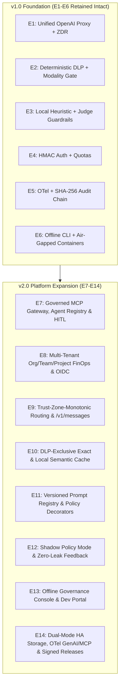

# Platform Product Requirements Document (PRD v2.0)

> **Relationship to v1.0 Baseline:** This document extends [PRD_AND_USER_STORIES.md](PRD_AND_USER_STORIES.md) (`E1`–`E6`, `US-01`–`US-16`) into a complete, self-hosted enterprise AI platform (`E7`–`E14`, `US-17`–`US-36`). All v1.0 requirements and all 12 Non-Negotiable Security Invariants in [AGENTS.md](../../AGENTS.md)—plus Platform Invariants `#13`–`#16` defined in [FEATURE_EXTRACTION_AND_GAP_ANALYSIS.md](FEATURE_EXTRACTION_AND_GAP_ANALYSIS.md)—remain strictly binding.

---

## 1. Product Vision, Positioning & Strategic Pillars

### Vision Statement
Make `secure-ai-gateway` the **sovereign, zero-persistence AI control plane** for sensitive organizations—enabling engineers and autonomous agents to consume frontier, private-cloud, local models, and governed MCP tools through one air-gap-ready platform without leaking secrets, creating secondary PII honeypots, or locking into SaaS security vendors.

### Strategic Positioning
* **For** security-conscious engineering, AI platform, and compliance teams in regulated or IP-sensitive organizations
* **Who** need multi-model routing, MCP tool governance, FinOps chargeback, caching, and self-service governance without sending raw prompts or telemetry to external cloud control planes
* **Unlike** LiteLLM (heavy Postgres/Redis tax and 2026 supply-chain exposure), Portkey/PANW Prisma AIRS (SaaS/PANW lock-in), Kong Konnect (compound metered enterprise gating), Databricks Mosaic (lakehouse lock-in and raw Inference Tables), or Credal (sales-led RAG/data indexing footprint)
* **`secure-ai-gateway` v2.0** delivers full agent/MCP governance, intelligent routing, DLP-safe caching, prompt lifecycle, and an offline Governance Console on top of sub-10 ms deterministic DLP, RAM-only pseudonymization, and a tamper-evident zero-leak audit chain.

### Strategic Pillars
1. **Sovereign Zero-Persistence by Construction:** Zero raw prompt/secret/PII storage across logs, caches, audit ledgers, and OTel traces.
2. **Governed Agent & MCP Execution:** First-class non-human agent identities, parameter-scoped MCP proxying, and Human-in-the-Loop (HITL) safety gates.
3. **FinOps & Multi-Tenant Predictability:** Cascading `Org -> Team -> Project -> Key/Agent` budgets, modality-aware spend metering, and DLP-safe caching.
4. **Frictionless Air-Gapped Operations:** Single-node SQLite WAL out of the box, optional PostgreSQL + Valkey HA scale, zero-CDN offline UI, and signed/SBOM-verified builds.

### Explicit Non-Goals (Scope Guardrails Retained in v2.0)
* **Not an Enterprise RAG / Document Indexing Platform:** Never crawls or stores Google Drive, SharePoint, Salesforce, or Slack documents.
* **Not an LLM Training / Fine-Tuning Studio:** Does not manage training clusters, LoRA adapters, or RLHF datasets.
* **Not a Persistent Prompt/Conversation Memory Store:** Does not store user chat histories or raw Inference Tables.
* **Never Delegates DLP or Judging Externally:** Zero external cloud guardrail APIs or SaaS telemetry phone-home.

### 1.1 Target Demand & Deployment Profile (15+ Users on 2× NVIDIA DGX Spark)

`secure-ai-gateway` v2.0 is sized and prioritized around the organization's primary operational workload:

* **User & Concurrency Profile:** **15+ active internal engineers, analysts, and autonomous agents** (`1–20 RPS` typical sustained traffic, bursting up to `50 RPS` during concurrent agent runs and SSE streams).
* **Primary Upstream Demand:**
  1. **Large Hugging Face Compute on Paid Team Plan (`\$20/user/month` + Pooled Credits & Zero-Markup Pay-As-You-Go):** Heavy usage of **Hugging Face Inference Providers (`router.huggingface.co`)**, which dynamically route OpenAI-compatible requests to third-party inference partners (Together, Fireworks, Groq, Cerebras, Replicate, etc.). Because downstream retention depends on the executing partner, 100% of HF traffic is treated strictly as `trust_zone == "external"` with mandatory ZDR sub-provider pinning (blocking unvetted `:auto`/`:fastest` routing), while proprietary code reroutes locally to the **2× DGX Spark** enclave. Aligns with HF Team Plan SSO (SAML/OIDC), Resource Groups, Storage Region controls, and Org Audit Logs.
  2. **Closed Frontier Models via OpenAI Enterprise OAuth & API:** High demand for OpenAI `/v1/chat/completions` and **`/v1/responses`** (used by Codex and modern OAuth clients) brokered under corporate OpenAI tenant IDs—while **strictly blocking personal/consumer BYOS ChatGPT OAuth tokens**.
* **Target Hosting Hardware (`2× NVIDIA DGX Spark`):** Hosted internally on two clustered **NVIDIA DGX Spark** systems (`GB10 Grace Blackwell Superchip`, **128 GB unified LPDDR5x memory per node**, `200 Gbps ConnectX-7` SmartNIC interconnect, `10 GbE` LAN, **NVIDIA DGX OS `linux/arm64`**):
  * **Spark Node 1:** Primary gateway replica, storage/telemetry stack, and an always-warm `7B–8B` local LLM-as-a-Judge (`~6–10 GB`, leaving `> 100 GB` unified memory headroom).
  * **Spark Node 2:** Secondary HA gateway replica, local embedding model for DLP-exclusive semantic caching, and large private coding/fallback models (`32B–70B` or `200B` MoE FP4 inside `128 GB` unified memory, or `405B+` pooled across both nodes via `200 Gbps` ConnectX-7).

---

## 2. Expanded User Personas & Jobs-to-be-Done (JTBD)

| Persona | Primary Job-to-be-Done (JTBD) | Key v2.0 Platform Unlock |
| :--- | :--- | :--- |
| **Internal Software Engineer / AI App Developer** | "Give me one self-service endpoint for OpenAI, Anthropic, local models, versioned prompts, and approved MCP tools without waiting weeks on tickets." | Self-service Developer Catalog, `/v1/messages`, versioned prompt templates, semantic cache speedups, `X-Gateway-*` debugging headers |
| **Autonomous AI Agent / Service** | "Let me invoke internal MCP tools reliably with deterministic auth and parameter guardrails while pausing safely on high-risk writes." | Agent Registry credentials, `/v1/mcp/*` proxy, parameter scoping, structured HITL pending/approval states |
| **Security & Compliance Officer** | "Enforce zero-leak DLP, tune policies on live traffic without breaking production, review risky HITL actions, and prove tamper-free audits." | Shadow Policy Mode, `/v1/feedback` false-positive analytics, HITL Approval Queue, offline Audit Verifier, compliance prompt decorators |
| **Platform / SRE / FinOps Admin** | "Operate a signed, HA-capable gateway with OIDC SSO, cascading team chargebacks, soft budget alerts, and OTel `gen_ai.*`/`mcp.*` visibility." | Org/Team/Project hierarchy, `80%`/`90%` budget webhooks, Postgres + Valkey HA option, queue-wait metrics, signed SBOM releases |
| **Department / Team Lead** | "Track my team's AI spend by project and cost center, approve new agent manifests, and manage team developer keys securely." | Delegated Team Key lifecycle, cost-center FinOps dashboard, team-scoped HITL & Agent approval view |

---

## 3. Platform Capability Architecture (`E1`–`E14`)

---

## 4. Detailed Epics & User Stories (`E7`–`E14`, `US-17`–`US-36`)

### Epic E7: Governed MCP Gateway & Agent Identity Registry

#### US-17 — Unified MCP Proxy & Per-Tool RBAC (`P0`)
*Inspired by: LiteLLM MCP Gateway, Portkey MCP Gateway, Kong `ai-mcp-proxy`, Databricks Unity Catalog*
* **Story:** *As an Autonomous AI Agent / Service*, I want to discover and invoke approved MCP servers and tools through a single `/v1/mcp/*` gateway endpoint, *so that* I do not manage raw upstream credentials or bypass centralized authorization.
* **Acceptance Criteria (Given/When/Then):**
  * **Given** a caller authenticates with a valid gateway key or agent token, **When** it calls `GET /v1/mcp/tools` or `tools/list` via Streamable HTTP/SSE, **Then** the gateway returns only MCP servers and tools permitted by that caller's role and agent manifest.
  * **Given** a caller invokes an unauthorized tool (`tools/call`), **When** RBAC evaluation runs, **Then** the gateway rejects the call with HTTP `403` (`mcp_tool_unauthorized`) before contacting the upstream MCP server and logs a zero-leak audit event.
  * **Given** an upstream MCP server requires OAuth/bearer credentials, **When** the gateway proxies an authorized call, **Then** it injects server-side credentials via `EgressGuardTransport` / internal enclave allowlists without ever exposing upstream secrets to the client.
* **API / Config Surface:** `POST /v1/mcp/{server_id}/rpc`, `GET /v1/mcp/tools`, `config/mcp_servers.yaml` (server transport URL, auth binding, trust zone, allowed roles/agents).
* **Failure Semantics:** Upstream MCP server timeouts or transport errors fail closed with `503` (`mcp_upstream_unavailable`) and trip per-server circuit breakers.

#### US-18 — MCP Parameter Scoping & Pre/Post DLP and Guardrail Hooks (`P0`)
*Inspired by: Credal AI Parameter Constraints, LiteLLM `pre`/`post_mcp_call` Hooks*
* **Story:** *As a Security & Compliance Officer*, I want MCP tool arguments constrained by declarative parameter rules and scanned by deterministic DLP + injection guardrails both before and after tool execution, *so that* agents cannot exfiltrate bulk records or execute injected tool outputs.
* **Acceptance Criteria (Given/When/Then):**
  * **Given** a tool policy declares `max_limit: 50`, `allowed_schemas: ["public"]`, or regex/enum allowlists, **When** an agent calls the tool with `limit: 5000` or an unapproved schema, **Then** the gateway blocks the request (`403 mcp_parameter_violation`) with the violated rule ID and never echoes raw sensitive values.
  * **Given** an MCP tool call targets an external MCP server (`trust_zone == "external"`), **When** `pre_mcp_call` runs, **Then** deterministic DLP applies `BLOCK` / `REDACT` / `PSEUDONYMIZE` identically to chat requests (`<= 10 ms` SLO).
  * **Given** an MCP server returns tool output (`post_mcp_call`), **When** the payload contains prompt-injection signatures or Tier-1 secrets, **Then** the gateway flags `prompt_injection_or_jailbreak` / `SECRET` and blocks or redacts the result per policy before returning it to the calling agent.
* **API / Config Surface:** `config/mcp_policies.yaml` (`parameter_constraints`, `pre_call_dlp`, `post_call_guardrail`), headers `X-Gateway-MCP-Server`, `X-Gateway-MCP-Tool`.
* **Failure Semantics:** Deterministic `pre_mcp_call` DLP errors fail closed (`503`) on external MCP servers. Zero unauthenticated MCP test/debug endpoints may exist (eliminating RCE surfaces like `CVE-2026-42271`).

#### US-19 — Non-Human Agent Registry, Manifests & Scoped Credentials (`P0`)
*Inspired by: Credal AI Agent Registry, Kong A2A Credentials, Databricks Non-Human Principals*
* **Story:** *As a Platform / SRE Admin*, I want every autonomous agent registered with a versioned manifest, human owner, model/MCP allowlist, and distinct `gw_agent_...` HMAC credential, *so that* agentic blast radius is bounded and attributable independently of developer keys.
* **Acceptance Criteria (Given/When/Then):**
  * **Given** an admin registers an agent manifest (`agent_id`, `version`, `owner_user_id`, `team_id`, `allowed_models`, `allowed_mcp_tools`, `autonomy_tier`), **When** an agent token is minted, **Then** it uses `HMAC-SHA256` storage, displays plaintext once, and enforces manifest bounds on every LLM and MCP request.
  * **Given** an agent manifest is rolled back or suspended (`status: suspended`), **When** the agent sends a request, **Then** the gateway rejects it immediately with `401` (`agent_suspended`) and propagates revocation across workers within `<= 1 second`.
  * **Given** an agent executes chained LLM + MCP calls, **When** audit records and OTel traces are emitted, **Then** every record carries `agent_id`, `agent_version`, and `owner_team_id` without raw prompt data.
* **API / Config Surface:** `POST /admin/agents`, `PATCH /admin/agents/{agent_id}`, `POST /admin/agents/{agent_id}/rollback`, `POST /admin/agents/{agent_id}/keys`.
* **Failure Semantics:** Missing or expired agent ownership triggers automated warning notifications to the parent Team Lead.

#### US-20 — Human-in-the-Loop (HITL) Approval Gates for High-Risk Actions (`P1`)
*Inspired by: Credal AI HITL Approvals*
* **Story:** *As a Security & Compliance Officer*, I want high-risk agent `tool_calls` and MCP mutations (`risky_tool_invocation` or `autonomy_tier: hitl_required`) paused in a cryptographic approval queue until an authorized human approves or denies them, *so that* irreversible actions require human sign-off.
* **Acceptance Criteria (Given/When/Then):**
  * **Given** an agent attempts an MCP call or `tool_call` tagged `requires_hitl: true`, **When** policy evaluates the call, **Then** the gateway returns HTTP `202 Accepted` (`status: pending_approval`, `approval_id`, `expires_at`) and dispatches a zero-leak webhook notification (action summary + SHA-256 argument digest, never raw secrets/PII).
  * **Given** an authorized reviewer approves `approval_id` via `POST /admin/approvals/{approval_id}/decision` or the Governance Console within TTL, **When** the agent polls or replays with `X-Gateway-Approval-Id: {approval_id}`, **Then** the gateway verifies single-use cryptographic binding to the exact request hash and executes the call.
  * **Given** a request is denied or TTL expires, **When** the agent checks status, **Then** the gateway returns `403` (`approval_denied` / `approval_expired`) and records the reviewer ID and timestamp in the hash-chained audit ledger.
* **API / Config Surface:** `GET /admin/approvals`, `POST /admin/approvals/{approval_id}/decision`, `GET /v1/approvals/{approval_id}/status`, headers `X-Gateway-Approval-Id`, `X-Gateway-Approval-Status`.
* **Failure Semantics:** Unapproved or tampered request payloads (hash mismatch on replay) fail closed (`403`).

---

### Epic E8: Multi-Tenant Hierarchy, Chargeback & FinOps Governance

#### US-21 — Org / Team / Project Hierarchy & Cascading Budgets (`P0`)
*Inspired by: LiteLLM Org/Team/Key Hierarchy, Portkey Workspaces, Databricks Accounts*
* **Story:** *As a Platform / SRE / FinOps Admin*, I want API keys and agent identities organized under `Organization -> Team -> Project` with cascading RPM, TPM, and daily/monthly USD caps, *so that* spend and rate limits are governed at every organizational boundary.
* **Acceptance Criteria (Given/When/Then):**
  * **Given** an Organization (`\$10,000/mo`), Team (`\$2,000/mo`), Project (`\$500/mo`), and Key (`\$100/day`) hierarchy, **When** a request arrives, **Then** the gateway evaluates all ancestor quotas atomically and rejects (`429` for RPM/TPM, `402`/`429` `budget_exceeded`) if *any* level is exhausted.
  * **Given** an existing v1.0 flat key without explicit tenant metadata, **When** upgraded to v2.0, **Then** it maps seamlessly to a `default` Org/Team/Project preserving backward compatibility.
* **API / Config Surface:** `POST /admin/tenants/orgs`, `POST /admin/tenants/teams`, `POST /admin/tenants/projects`, header `X-Gateway-Project-Id`.
* **Failure Semantics:** Quota store failure on external traffic fails closed (`503`) to prevent unbudgeted spend spikes.

#### US-22 — Soft Budget Webhooks, Cost-Center Tagging & Per-Subprovider Modality Spend Accounting (`P1`)
*Inspired by: Databricks Soft Alerts, Kong Modality Cost Tracking, LiteLLM Spend Tags, HF Team Plan Inference Providers Billing*
* **Story:** *As a Department / Team Lead*, I want non-blocking soft budget alerts at `80%` and `90%` utilization, `X-Gateway-Cost-Center` chargeback tags, separate metering for text/audio/image/cached tokens, **and per-sub-provider (`hf_subprovider`) spend breakdown across Hugging Face Inference Providers**, *so that* teams avoid sudden cutoffs and finance gets accurate attribution by cost center and upstream hardware partner.
* **Acceptance Criteria (Given/When/Then):**
  * **Given** a Team or Project crosses `80%` or `90%` of its monthly USD budget, **When** the usage ledger updates, **Then** the gateway triggers an idempotent internal webhook alert once per threshold window and attaches `X-Gateway-Budget-Warning: 80%` without blocking traffic.
  * **Given** a request carries `X-Gateway-Cost-Center`, `X-Gateway-Env`, or maps to a Hugging Face Team Resource Group and pinned `:provider`, **When** completion finishes, **Then** Prometheus metrics and audit summaries attribute modality-adjusted USD cost (`input`, `output`, `cached_read`, `image`, `audio`) to that cost center and `hf_subprovider`.
* **API / Config Surface:** Headers `X-Gateway-Cost-Center`, `X-Gateway-Budget-Warning`, `X-Gateway-HF-Subprovider`; Prometheus labels `team_id`, `project_id`, `cost_center`, `modality`, `hf_subprovider`.
* **Failure Semantics:** Webhook dispatch failures never block or slow the proxy response path (async bounded queue).

#### US-23 — Pluggable OIDC / SAML SSO & Delegated Team Key Lifecycle (`P2`)
*Inspired by: LiteLLM Enterprise SSO, Portkey RBAC, Kong OIDC*
* **Story:** *As a Platform / SRE Admin*, I want built-in air-gap-compatible OIDC/SSO (e.g., local Keycloak, Dex, ADFS, Okta) mapping identity groups to Team Admin, Security Officer, Auditor, and Developer roles, *so that* key provisioning and console access require zero commercial enterprise paywalls.
* **Acceptance Criteria (Given/When/Then):**
  * **Given** an OIDC issuer configured via local JWKS file or internal URL, **When** a user signs into the Governance Console or CLI, **Then** claims map deterministically to gateway roles (`org_admin`, `team_lead`, `security_officer`, `auditor`, `developer`).
  * **Given** a `team_lead` logs in, **When** they create or revoke keys, **Then** actions are strictly scoped to projects inside their own team and recorded in the hash-chained audit ledger.
* **API / Config Surface:** `config/auth_oidc.yaml`, `POST /admin/auth/oidc/callback`, `GET /admin/roles`.
* **Failure Semantics:** Invalid/expired OIDC tokens or missing group claims deny access (`401`/`403`) with zero fallback to anonymous admin access.

---

### Epic E9: Intelligent Trust-Zone-Aware Routing & Multi-Protocol Breadth

#### US-24 — Weighted Canary / A-B Traffic Splitting (`P1`)
*Inspired by: Databricks Traffic Splitting, Portkey Weighted Load Balancing*
* **Story:** *As a Platform / SRE Admin*, I want logical model aliases to support weighted traffic splits (e.g., `90%` `local/qwen2.5-32b` and `10%` `local/llama3.3-70b`) with optional deterministic sticky-session hashing, *so that* we can safely benchmark new models before full cutover.
* **Acceptance Criteria (Given/When/Then):**
  * **Given** a virtual model group `team/coding-canary` with weights summing to `100`, **When** 1,000 requests arrive, **Then** traffic distributes within `±3%` of configured weights and reports `X-Gateway-Routed-Model` and `X-Gateway-Route-Strategy: weighted_split`.
  * **Given** a target in a split belongs to `trust_zone == "external"` while the caller's role permits only `local`, **When** config loads or a request evaluates, **Then** config validation rejects unsafe mixed-zone splits unless explicitly marked `external_allowed` and scanned by fail-closed DLP.
* **API / Config Surface:** `config/models.yaml` (`virtual_groups` with `weights`, `sticky_header`), header `X-Gateway-Route-Strategy`.
* **Failure Semantics:** Weights not summing to `100` fail startup config validation.

#### US-25 — Declarative Fallback Chains with Strict Trust-Zone Monotonicity (`P1`)
*Inspired by: LiteLLM & Portkey Fallback Chains*
* **Story:** *As an Internal Software Engineer*, I want ordered fallback chains across healthy endpoints when an upstream returns `429`/`5xx` or trips a circuit breaker—while guaranteeing local-only or DLP-rerouted prompts never leak to an external model, *so that* resilience never compromises data sovereignty.
* **Acceptance Criteria (Given/When/Then):**
  * **Given** an external request fails pre-stream with `429` or `503`, **When** fallback policy specifies `[openrouter/claude-3.5-sonnet, openai/gpt-4o-mini, local/llama3.2]`, **Then** the router retries the next healthy endpoint (re-applying provider-specific ZDR/payload rules) and sets `X-Gateway-Fallback-Used: true`.
  * **Given** a request originated in `trust_zone == "local"` or was downgraded by DLP `REROUTE_LOCAL`, **When** the local model fails, **Then** the router **never** falls back to any `trust_zone == "external"` target (Invariant #13) and returns `503` if no secondary local model is healthy.
  * **Given** the caller sets `X-Gateway-No-Fallback: true`, **When** the primary model fails or DLP triggers `REROUTE_LOCAL`, **Then** all fallbacks are skipped and `403`/`503` is returned directly.
* **API / Config Surface:** `config/models.yaml` (`fallback_chain`), headers `X-Gateway-Fallback-Used`, `X-Gateway-No-Fallback`.
* **Failure Semantics:** Pre-stream retries only; once SSE chunks begin streaming to client, mid-stream failover is forbidden to avoid corrupted output.

#### US-26 — OpenAI Enterprise OAuth (`/v1/responses`), Hugging Face Inference Providers, `/v1/messages` & Complexity Auto-Routing (`P0`)
*Inspired by: LiteLLM Auto-Router, Kong Semantic Routing, Credal Anthropic Support, Hugging Face Inference Providers*
* **Story:** *As an Internal Software Engineer*, I want seamless access to **OpenAI closed models via corporate OAuth (`/v1/chat/completions` & `/v1/responses`)**, **Hugging Face Paid Team ZDR-pinned Inference Providers (`router.huggingface.co`)**, Anthropic `/v1/messages`, private VPC cloud adapters, and optional complexity auto-routing, *so that* Codex, Hugging Face workloads, and multi-SDK agents run safely through one governed gateway.
* **Acceptance Criteria (Given/When/Then):**
  * **Given** a client calls `POST /v1/responses` or `POST /v1/chat/completions` presenting a corporate OpenAI OAuth token, **When** the gateway validates the token, **Then** it verifies membership in the pinned corporate OpenAI org/tenant ID (`X-Gateway-OAuth-Tenant`), rejects personal/consumer BYOS ChatGPT OAuth accounts (`403 personal_oauth_prohibited`), never persists OAuth access/refresh tokens, and runs the full DLP + RAM `TokenVault` SSE restore + guardrail pipeline.
  * **Given** a request targets a **Hugging Face Paid Team** model alias (`provider_type: huggingface_providers` via `router.huggingface.co`), **When** processed, **Then** it enforces `trust_zone == "external"` fail-closed DLP + RAM pseudonymization, requires an explicit ZDR-approved `:provider` suffix from `allowed_hf_subproviders` (blocking unvetted `:auto`, `:fastest`, or `:cheapest` routing), and emits `X-Gateway-HF-Subprovider`.
  * **Given** an Anthropic SDK client calls `POST /v1/messages` (sync or SSE) or an alias uses `auto/cost-optimized`, **When** processed, **Then** `/v1/messages` undergoes full DLP/TokenVault/guardrail inspection and `auto/cost-optimized` routes low-complexity clean prompts (`< 3 ms` local classifier) to local DGX Spark models while honoring trust-zone boundaries.
* **API / Config Surface:** `POST /v1/responses`, `POST /v1/messages`, `config/models.yaml` (`provider_type: openai_oauth | huggingface_providers | anthropic | bedrock | azure | vertex`, `allowed_hf_subproviders`, `block_unvetted_hf_routing`, `allowed_openai_tenant_ids`, `auto_router`), headers `X-Gateway-OAuth-Tenant`, `X-Gateway-HF-Subprovider`.
* **Failure Semantics:** Unverified OAuth tenant claims, unapproved Hugging Face sub-providers, or disallowed `:auto`/`:fastest` suffixes fail closed (`403`). Auto-router classifier errors fall back safely to the caller's default authorized tier without skipping DLP.

---

### Epic E10: Privacy-Safe Exact & Local Semantic Caching

#### US-27 — Tenant-Isolated Exact & Local-Embedding Semantic Cache with DLP-Safe Exclusion (`P1`)
*Inspired by: Portkey & Kong Semantic Caching, LiteLLM Valkey/Qdrant Cache*
* **Story:** *As a Platform / SRE / FinOps Admin*, I want exact-match and local-embedding semantic caching that isolates entries per tenant/role/policy version and never caches DLP-sensitive requests, *so that* repetitive safe queries return in `< 5 ms` without cross-tenant or PII leakage.
* **Acceptance Criteria (Given/When/Then):**
  * **Given** a request contains zero Tier-1/2/3 DLP findings, zero `TokenVault` placeholders, and `temperature <= cache_max_temp`, **When** an exact hash or local-embedding similarity (`>= threshold`, default `0.94`) matches within the same `(org_id, team_id, role_id, model, policy_version_hash)` namespace, **Then** the gateway returns the cached completion in `< 5 ms` without calling upstream.
  * **Given** a request triggered `PSEUDONYMIZE`, `REDACT`, `REROUTE_LOCAL`, or `BLOCK`—or contains restricted modalities—**When** evaluated, **Then** the gateway **skips both cache lookup and cache write** (Invariant #14) and sets `X-Gateway-Cache-Status: bypass_dlp`.
  * **Given** `policy_version_hash` changes (e.g., stricter DLP or guardrail rule deployed), **When** subsequent requests arrive, **Then** prior cached entries miss automatically due to namespace versioning.
* **API / Config Surface:** `config/cache.yaml` (`backend: memory | sqlite_vec | valkey`, `local_embedding_model_path`, `similarity_threshold`, `ttl_seconds`).
* **Failure Semantics:** Cache store errors degrade gracefully to `cache_miss` (`X-Gateway-Cache-Status: error_bypass`) and never block or bypass DLP/guardrails.

#### US-28 — Cache Control Headers, Bypass Directives & FinOps Savings Telemetry (`P2`)
*Inspired by: LiteLLM Cache Headers, Kong AI Cache Analytics*
* **Story:** *As an Internal Software Engineer*, I want standard cache directives (`Cache-Control: no-store`, `X-Gateway-Cache-TTL`) and explicit cache hit/savings telemetry, *so that* latency-sensitive apps control freshness and FinOps proves ROI.
* **Acceptance Criteria (Given/When/Then):**
  * **Given** a request includes `X-Gateway-Cache-Control: no-cache` or `no-store`, **When** processed, **Then** cache read and/or write are skipped and `X-Gateway-Cache-Status: bypass_client` is returned.
  * **Given** a cache hit occurs, **When** metrics and audit summaries update, **Then** `gateway_cache_hits_total` and `gateway_cache_saved_usd_total` increment while `gateway_tokens_total` records `cached_hit` separately from billed upstream tokens.
* **API / Config Surface:** Request headers `X-Gateway-Cache-Control`, `X-Gateway-Cache-TTL`; response header `X-Gateway-Cache-Status` (`hit_exact | hit_semantic | miss | bypass_dlp | bypass_client`).
* **Failure Semantics:** Invalid TTL header bounds fall back to policy default TTL or reject with `400` if strict validation is enabled.

---

### Epic E11: Governed Prompt Registry, Templates & Policy Decorators

#### US-29 — Versioned Prompt Templates & Mandatory Compliance Decorators (`P1`)
*Inspired by: Portkey Prompt Library & Partials, Kong `ai-prompt-template` & `ai-prompt-decorator`*
* **Story:** *As a Security & Compliance Officer*, I want standardized parameterized prompt templates and mandatory gateway-injected system compliance decorators, *so that* internal apps avoid prompt drift and consistently enforce organizational safety framing.
* **Acceptance Criteria (Given/When/Then):**
  * **Given** a registered prompt template `legal-summary@v3` with typed variable schemas, **When** a caller sends `X-Gateway-Prompt-Id: legal-summary` and `prompt_variables`, **Then** the gateway compiles the prompt server-side, runs deterministic DLP + guardrails on the *rendered* text, and forwards it upstream.
  * **Given** a role or project has an active `policy_decorator` (e.g., mandatory confidentiality framing or output constraint), **When** any request matches that scope, **Then** the gateway prepends/appends the decorator automatically before DLP/guardrail/judge checks.
  * **Given** a role sets `require_registered_prompt: true`, **When** a caller sends free-form raw `messages` without an approved template ID, **Then** the gateway rejects with `403` (`unapproved_prompt_template`).
* **API / Config Surface:** `POST /admin/prompts`, `POST /admin/prompts/{id}/versions`, `config/prompts.yaml`, headers `X-Gateway-Prompt-Id`, `X-Gateway-Prompt-Version`.
* **Failure Semantics:** Missing required template variables or schema mismatches fail fast with `400` (`invalid_prompt_variables`).

#### US-30 — Immutable Prompt Pinning, GitOps Sync & Safe Rollback (`P2`)
*Inspired by: Portkey Prompt Versioning & Publishing*
* **Story:** *As an Internal Software Engineer*, I want applications to pin immutable prompt versions (`v3`) or track environment tags (`production`, `staging`) synced from GitOps YAML with instant rollback, *so that* prompt updates never cause surprise production regressions.
* **Acceptance Criteria (Given/When/Then):**
  * **Given** a published prompt version `v3`, **When** a developer updates a prompt, **Then** it creates immutable `v4` without mutating `v3` and supports one-click/CLI tag reassignment (`production -> v3`) for instant rollback.
  * **Given** an air-gapped CI/CD pipeline runs `gateway-cli prompts sync ./prompts.yaml`, **When** applied, **Then** versions validate deterministically and recompute `policy_version_hash`.
* **API / Config Surface:** `POST /admin/prompts/{id}/promote`, `gateway-cli prompts sync`, audit field `prompt_template_ref`.
* **Failure Semantics:** Prompt template definitions may not contain raw secrets; secret detector runs on prompt registration and blocks unsafe templates.

---

### Epic E12: Policy Shadow Mode, Zero-Leak Feedback & Eval Hooks

#### US-31 — Live Shadow Policy Evaluation Mode (`P0`)
*Inspired by: Portkey Evals, Databricks Safe Rollout*
* **Story:** *As a Security & Compliance Officer*, I want to attach a candidate DLP/guardrail policy bundle in `shadow` mode against live traffic, *so that* I can measure true trigger rates and latency impact before enforcing blocks in production.
* **Acceptance Criteria (Given/When/Then):**
  * **Given** an active `shadow_policy` configured alongside the enforcing `active_policy`, **When** live requests arrive, **Then** only `active_policy` governs blocking/rerouting/headers while `shadow_policy` evaluates asynchronously within bounded worker budgets (`<= 15 ms` DLP budget).
  * **Given** shadow findings occur, **When** recorded, **Then** only aggregated trigger counts, category deltas (`active_allow_shadow_block`), and HMAC digests are stored—never raw prompt text.
* **API / Config Surface:** `POST /admin/policies/shadow`, `GET /admin/policies/shadow/diff`, `DELETE /admin/policies/shadow`.
* **Failure Semantics:** Shadow evaluation timeouts or errors increment shadow-error metrics and **never** delay or fail the live client response.

#### US-32 — Privacy-Safe `/v1/feedback` API & Guardrail Precision/Recall Analytics (`P1`)
*Inspired by: Portkey Weighted User Feedback*
* **Story:** *As an Internal Software Engineer*, I want to submit structured feedback (`false_positive_dlp`, `false_positive_guardrail`, `quality_rating`) tied to `X-Gateway-Request-Id`, *so that* security and platform teams can tune noisy rules without seeing my raw prompt.
* **Acceptance Criteria (Given/When/Then):**
  * **Given** a completed request returned `X-Gateway-Request-Id: req_abc123`, **When** the client posts `{request_id, signal_type, score, reason_code}` to `POST /v1/feedback`, **Then** the gateway validates the `request_id` exists in the audit ledger, verifies caller tenant match, and stores the feedback linked to the triggered rule/category IDs.
  * **Given** a user submits free-text comments in feedback, **When** persisted, **Then** deterministic DLP strips/rejects any detected secrets/PII so `/v1/feedback` never becomes a leakage side-channel.
* **API / Config Surface:** `POST /v1/feedback`, `GET /admin/analytics/feedback`, header `X-Gateway-Request-Id`.
* **Failure Semantics:** Unrecognized `request_id` or cross-tenant feedback submissions return `404`/`403`.

---

### Epic E13: Offline Self-Hosted Governance Console & Developer Portal

#### US-33 — Offline Self-Hosted Admin Governance Console (`P1`)
*Inspired by: LiteLLM Admin UI, Portkey Control Plane*
* **Story:** *As a Security & Compliance Officer*, I want a single-origin, zero-CDN web console served directly by the gateway (or dedicated internal container) for FinOps spend dashboards, Policy Dry-Run/Shadow Diff, HITL Approval Queue, and Hash-Chain Audit Verification, *so that* non-CLI stakeholders can govern AI safely inside air-gapped networks.
* **Acceptance Criteria (Given/When/Then):**
  * **Given** an air-gapped browser session with zero internet access, **When** an authenticated Security Officer or FinOps Admin opens `/console`, **Then** all JS/CSS/font assets load strictly from local bundle with strict CSP (`default-src 'self'`) and zero external requests.
  * **Given** the Security Officer views the Audit or HITL queue, **When** data renders, **Then** zero raw prompts, raw secrets, or raw PII appear anywhere in UI responses—only counts, categories, HMAC digests, rule IDs, and redaction summaries.
* **API / Config Surface:** `GET /console/*`, backed exclusively by RBAC-protected `/admin/*` APIs.
* **Failure Semantics:** Disabled cleanly via `console.enabled: false` for headless API-only enclaves.

#### US-34 — Internal Developer Model/MCP/Prompt Catalog & Self-Service Key Portal (`P2`)
*Inspired by: Kong Developer Portal, Portkey Prompt Catalog*
* **Story:** *As an Internal Software Engineer*, I want an internal self-service portal listing models, trust zones, MCP tools, and prompt templates authorized for my role—plus one-click scoped key creation within my team quota—*so that* onboarding takes minutes without Slack tickets.
* **Acceptance Criteria (Given/When/Then):**
  * **Given** an engineer logs in via OIDC or scoped developer token, **When** viewing `/console/catalog`, **Then** they see only models (`trust_zone`, latency/cost tier), MCP tools, and prompts permitted to their team/role, along with copyable SDK snippets.
  * **Given** a team allows self-service sandbox keys (`max_daily_usd: 10`), **When** the engineer requests a key, **Then** the portal displays the `gw_live_...` key once, stores its `HMAC-SHA256` hash, and enforces team ceilings automatically.
* **API / Config Surface:** `GET /v1/catalog` (RBAC-filtered), `POST /v1/self-service/keys`.
* **Failure Semantics:** Exceeding max active keys per user or lacking team self-service permission returns `403`.

---

### Epic E14: Enterprise Scale, HA Storage & Supply-Chain Assurance

#### US-35 — Pluggable Dual-Mode HA Storage (SQLite Default → Postgres + Valkey HA) & Atomic Revocation (`P1`)
*Inspired by: LiteLLM Scaling Lessons (eliminating mandatory DB tax + fixing revocation cache drift)*
* **Story:** *As a Platform / SRE Admin*, I want single-node deployments to run zero-dependency on SQLite WAL while multi-replica Kubernetes clusters switch seamlessly via config to PostgreSQL + Valkey/Redis with sub-second key/agent revocation propagation, *so that* we start simple and scale without vendor re-architecture.
* **Acceptance Criteria (Given/When/Then):**
  * **Given** `storage.backend: sqlite`, **When** the gateway boots, **Then** it requires zero external database or cache services and preserves all v1.0 serialized hash-chain guarantees.
  * **Given** `storage.backend: postgres_valkey` across 3+ gateway replicas, **When** a key or agent is revoked on Replica A, **Then** Valkey pub/sub invalidates in-memory auth caches across Replicas B and C within `<= 1 second` (Invariant #16).
  * **Given** concurrent audit writes occur across multiple replicas in Postgres mode, **When** computing `SHA256(prev_hash + "|" + canonical_json)`, **Then** database advisory/serializable locking prevents hash-chain forks.
* **API / Config Surface:** `config/gateway.yaml` (`storage.backend: sqlite | postgres_valkey`), `GET /readyz` (reports storage & pub/sub readiness).
* **Failure Semantics:** In HA mode, if Valkey pub/sub disconnects, replicas fall back immediately to direct Postgres key checks (`fail-secure`, zero stale cache window).

#### US-36 — Verifiable Air-Gap Supply Chain, OTel `gen_ai.*`/`mcp.*` Conformance & Queue-Wait Metrics (`P0`)
*Inspired by: LiteLLM 2026 Supply-Chain Incidents & Pre-Handler Queue Blind Spot, OTel GenAI Semantic Conventions*
* **Story:** *As a Platform / SRE Admin*, I want cryptographically signed container releases with offline SPDX SBOMs, standardized OTel `gen_ai.*` and `mcp.*` spans (with prompt capture disabled), and explicit ASGI pre-handler queue-wait telemetry, *so that* we prevent supply-chain compromise and detect event-loop saturation early.
* **Acceptance Criteria (Given/When/Then):**
  * **Given** every release artifact, **When** deployed in an air-gapped registry, **Then** operators can verify locked dependency hashes, `cosign` container signatures, and an embedded SPDX SBOM without internet access.
  * **Given** OTel tracing is enabled for LLM and MCP requests, **When** spans export, **Then** they conform to `gen_ai.system`, `gen_ai.request.model`, `gen_ai.usage.*`, `mcp.method.name`, `mcp.session.id`, `mcp.protocol.version`, and `mcp.resource.uri`—with raw prompt/response span events **strictly disabled** by policy.
  * **Given** high concurrency saturates worker event loops, **When** requests enter middleware, **Then** `gateway_asgi_queue_wait_seconds` measures arrival-to-handler delta and exposes saturation alerts before upstream timeouts cascade.
* **API / Config Surface:** Prometheus `gateway_asgi_queue_wait_seconds` histogram; OTel attributes `gen_ai.*` & `mcp.*`.
* **Failure Semantics:** Startup self-check verifies `capture_raw_prompts == false` and rejects insecure telemetry overrides.

---

## 5. Non-Functional Requirements (NFRs) & Platform SLO Matrix

| Subsystem / Dimension | Target SLO | Measurement & Verification |
| :--- | :--- | :--- |
| **Deterministic DLP + Heuristics (4KB prompt)** | `< 10 ms` p95 | Offline benchmark suite (`test_performance.py`) |
| **Exact / Local Semantic Cache Hit Latency** | `< 5 ms` p95 | In-memory / Valkey / local vector index benchmark |
| **MCP Proxy Overhead (RBAC + Param Scope + Pre/Post DLP)** | `< 15 ms` p95 (excluding upstream MCP tool time) | Mocked Streamable HTTP / SSE MCP transport test |
| **Atomic Key / Agent Revocation Propagation (HA)** | `<= 1.0 s` across all replicas | Multi-worker Valkey pub/sub + fail-secure fallback test |
| **ASGI Pre-Handler Queue Wait** | `< 5 ms` p99 at rated concurrency | `gateway_asgi_queue_wait_seconds` load test |
| **HITL Webhook Notification Dispatch** | `< 50 ms` async enqueue | Non-blocking background dispatcher test |
| **Single-Node Base Memory Footprint** | `< 180 MB` RSS per worker (SQLite mode) | Container memory profiling on `linux/arm64` DGX OS (vs ~500 MB LiteLLM baseline) |
| **Target Hardware & Cluster Capacity** | `linux/arm64` (`aarch64`) builds; `>= 50 RPS` burst on **2× NVIDIA DGX Spark** (`15+` users) | Multi-arch build verification + 2-node ConnectX-7 load test |
| **OpenAI `/v1/responses` & HF SSE Integrity** | `100%` chunk-safe `TokenVault` restore across `/v1/chat/completions`, `/v1/responses`, `/v1/messages`, HF streams | Mocked chunk-split SSE suite across all protocol adapters |
| **Platform Availability (HA Postgres+Valkey Mode)** | `99.95%` (excluding upstream provider outages) | Multi-replica `/readyz` + 2-node DGX Spark failover tests |
| **Zero-Leak & Air-Gap Verification** | `0` raw secrets/PII persisted; `0` outbound test calls | Offline CI suite (`pytest`, `ruff`, `mypy`, `MockTransport`) |

---

## 6. Security Invariant Preservation Matrix (`E7`–`E14`)

| Epic | Preserved v1.0 Invariants (`#1`–`#12`) | New Platform Invariants (`#13`–`#16`) & Enforcement Mechanism |
| :--- | :--- | :--- |
| **E7 (MCP & Agents)** | `#1` Zero Persistence, `#2` Fail-Closed DLP, `#6` Judge Nonce, `#9` HMAC Keys, `#10` Egress Allowlist, `#12` Serialized Audit | **`#15` Zero-Injection Parameter-Scoped MCP:** Declarative param bounds, pre/post DLP, zero debug execution routes; HITL stores only request SHA-256 digests. |
| **E8 (Multi-Tenant FinOps)** | `#1` Zero Persistence, `#9` HMAC Keys, `#12` Serialized Audit | Cascading quota checks before dispatch; OIDC local JWKS verification; chargeback tags + per-HF-sub-provider (`hf_subprovider`) token spend attribution validated against strict allowlists. |
| **E9 (Intelligent Routing)** | `#2` Fail-Closed DLP, `#5` Local Judge, `#8` Respect `No-Fallback`, `#10` Egress Guard, `#11` OpenRouter ZDR | **`#13` Trust-Zone Monotonicity:** Local/rerouted traffic never fails over externally; corporate OpenAI OAuth tokens pinned & never persisted (personal BYOS blocked); HF Inference Providers ZDR-allowlisted (`:auto`/`:fastest` blocked). |
| **E10 (Privacy-Safe Cache)** | `#1` Zero Persistence, `#4` RAM-Only `TokenVault` | **`#14` DLP-Exclusive Tenant-Isolated Cache:** Cache keys include `(tenant, role, model, policy_hash)`; zero cache read/write on any sensitive finding. |
| **E11 (Prompt Registry)** | `#1` Zero Persistence, `#2` Fail-Closed DLP, `#6` Judge Nonce | Secrets detector scans templates at registration; DLP + guardrails inspect final rendered + decorated payload before egress. |
| **E12 (Shadow & Feedback)** | `#1` Zero Persistence, `#12` Serialized Audit | Shadow mode logs only trigger counts/deltas; `/v1/feedback` runs DLP scrubbing on optional comment fields and binds via `request_id`. |
| **E13 (Offline Console)** | `#1` Zero Persistence, `#9` HMAC Keys, `#12` Serialized Audit | Zero-CDN single-origin bundle, strict CSP, role-scoped `/admin/*` & `/v1/catalog` APIs, zero raw prompt fields in API schemas. |
| **E14 (HA & Supply Chain)** | `#1` Zero Persistence, `#9` HMAC Keys, `#12` Serialized Audit | **`#16` Verifiable Supply Chain & Atomic Revocation:** Pinned deps + `cosign` + SBOM; Postgres advisory lock on audit chain; `<= 1s` Valkey revocation. |
