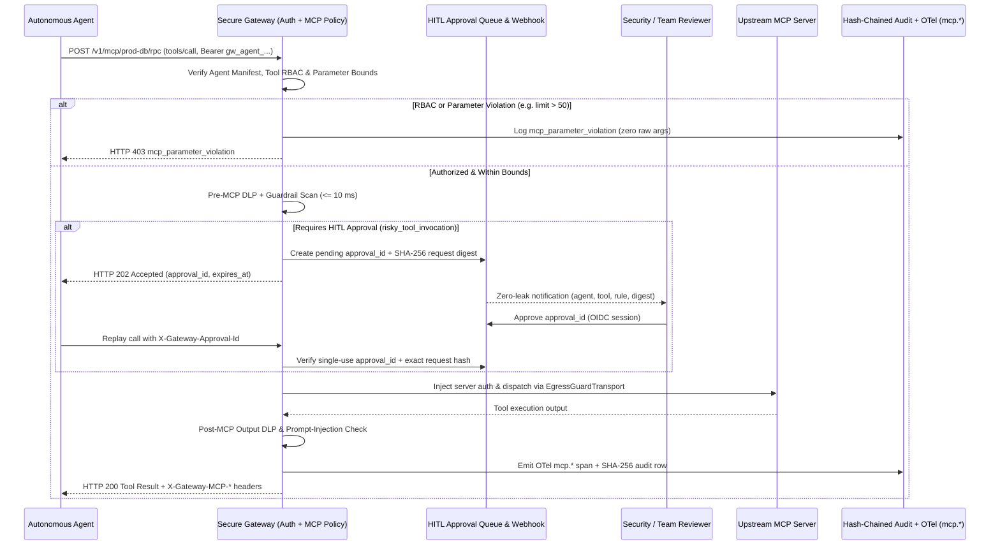
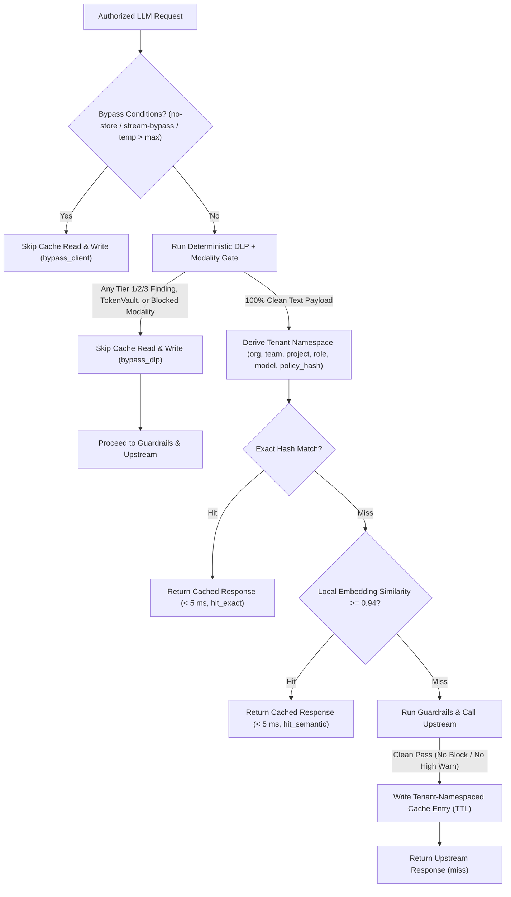
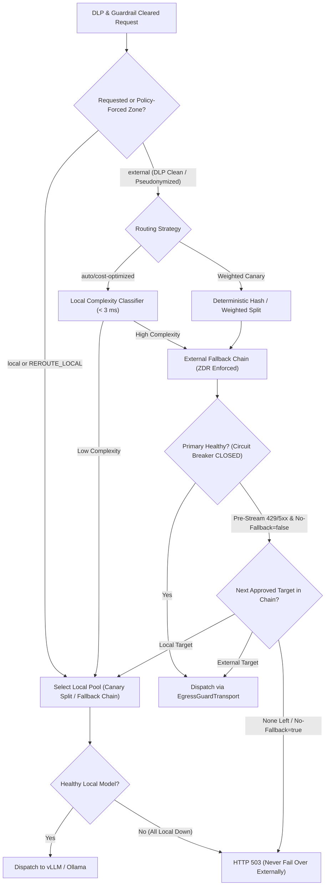
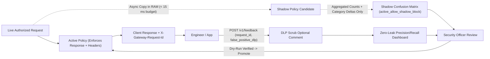
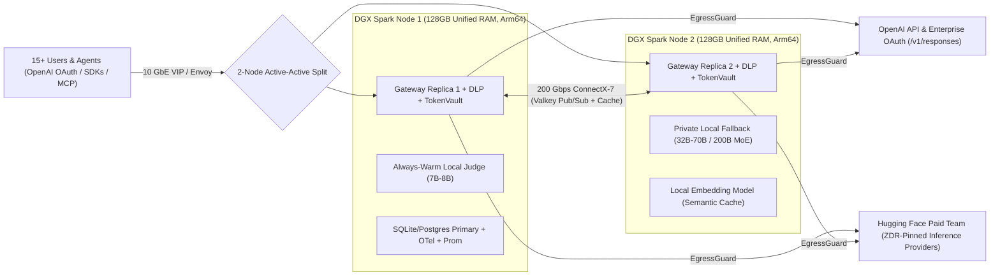
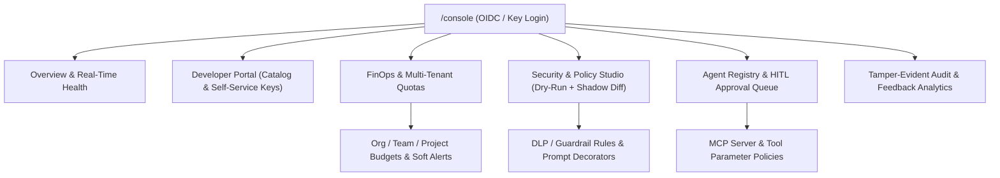

# Platform Workflows, UX Specifications & API Surface (`v2.0`)

> **Companion Document:** Extends [VISUAL_WORKFLOWS.md](VISUAL_WORKFLOWS.md) with v2.0 platform runtime flows (`E7`–`E14`), offline Governance Console & Developer Portal UX specifications, and API/header contracts defined in [PLATFORM_PRD_V2.md](PLATFORM_PRD_V2.md).

---

## 1. Governed MCP Tool Execution & HITL Approval Flow (`E7`)

Every autonomous agent invocation of `/v1/mcp/{server_id}/rpc` enforces identity verification, declarative parameter scoping, pre/post DLP and prompt-injection checks, and optional Human-in-the-Loop (HITL) sign-off before irreversible actions execute.

---

## 2. Privacy-Safe Exact & Local Semantic Cache Flow (`E10`)

To slash latency (`< 5 ms` cache hits) without violating **Invariant #1 (Zero Persistence)** or **Invariant #14 (DLP-Exclusive Tenant-Isolated Caching)**, caching executes strictly *after* deterministic DLP and *only* for clean, tenant-scoped payloads.

---

## 3. Trust-Zone-Monotonic Intelligent Routing Flow (`E9`)

Dynamic canary splitting, complexity auto-routing, and multi-provider fallback chains obey **Invariant #13 (Trust-Zone Monotonicity)**: traffic originating in or downgraded to `local` may never fail over to an `external` model.

---

## 4. Shadow Policy Rollout & Zero-Leak Feedback Loop (`E12`)

Security Officers validate new DLP rules and local guardrail thresholds on live production traffic without blocking users or storing raw prompts, then refine noisy rules using structured `/v1/feedback` signals.

---

## 5. 2× NVIDIA DGX Spark Target Deployment & Upstream Topology

To serve **15+ active users** (`1–20 RPS` sustained, `50 RPS` burst) demanding **large Hugging Face Paid Team compute** and **OpenAI Enterprise OAuth (`/v1/responses` + `/v1/chat/completions`)**, the gateway runs on two networked **NVIDIA DGX Spark (`linux/arm64`)** nodes linked via `200 Gbps` ConnectX-7:

---

## 6. Offline Governance Console & Developer Portal UX Specifications (`E13`)

The Governance Console (`/console`) is served as a single-origin, zero-CDN static bundle (`Content-Security-Policy: default-src 'self'`) consuming only `/admin/*` and `/v1/catalog` APIs.

### 6.1 Information Architecture & Sitemap

### 6.2 Role-Based Screen Access Matrix

| Console Module | Internal Engineer | Team Lead | Security & Compliance Officer | Platform / SRE / FinOps Admin |
| :--- | :---: | :---: | :---: | :---: |
| **Developer Model, MCP & Prompt Catalog** | View (Own Role) + Copy Snippets | View (Team Scope) | View (All) | Full Config |
| **Self-Service Scoped API Keys** | Create/Revoke Own Sandbox Keys | Create/Revoke Team Keys | Read Only (Hashes/Meta) | Full Org Key Lifecycle |
| **FinOps Spend & Cache Savings** | Own Key Usage Only | Team & Project Attribution | Read Only | Full Org Chargeback & Alerts |
| **Policy Dry-Run & Shadow Diff Studio** | Read Only (Dry-Run Self-Test) | Read Only | **Full Dry-Run, Shadow & Promote** | Config & Latency View |
| **Agent Registry & HITL Approval Queue** | Submit Agent Manifest Draft | **Approve Team Agents & HITL** | **Approve / Deny Any HITL + Suspend** | Full Lifecycle & Rollback |
| **Audit Chain Verifier & Feedback** | Submit `/v1/feedback` | View Team Feedback Aggregates | **Run Verify + Inspect Zero-Leak Ledger** | Verify + Export SIEM |

### 6.3 Core Screen Specifications (Zero-Leak UX Rules)

| Screen | Primary Layout & Components | Primary User Actions | Zero-Leak Display Guardrail | Empty & Error States |
| :--- | :--- | :--- | :--- | :--- |
| **1. FinOps & Quota Overview** | Top KPI cards (Total Spend, Cache Savings USD, Local Reroute Savings, **Spend by HF Sub-Provider**); stacked bar chart by `cost_center`, `hf_subprovider`, & `modality`; soft-alert banner list (`80%`/`90%`). | Filter by Org/Team/Project/Resource Group/`hf_subprovider`; edit soft-alert webhook; export CSV chargeback summary. | Displays token counts, sub-provider slugs, USD totals, and cost-center tags only; never displays request content. | *Empty:* Onboarding banner showing how to pass `X-Gateway-Cost-Center`. *Error:* Banner indicating quota DB read-only fallback. |
| **2. Policy Dry-Run & Shadow Diff Studio** | Split-pane view: Left = Dry-run input editor + role selector; Right = DLP findings, `PolicyAction`, sanitized preview, guardrail verdict; Bottom = Live Shadow Diff matrix. | Test sample text offline via `/admin/policy/dry-run`; inspect shadow delta counts (`active_allow_shadow_block`); promote shadow policy. | Dry-run test input stays ephemeral in browser/RAM; shadow diff shows only rule IDs and counts. | *Empty:* Sample synthetic test fixtures button (fake AWS key, fake NRIC). *Error:* Explicit inline banner if judge is in `degraded` state. |
| **3. HITL Approval Queue** | Filterable queue table (`approval_id`, `agent_id`, `mcp_server/tool`, `risk_category`, `ttl_remaining`, `request_sha256`); detail drawer with policy ref and constrained param summary. | One-click **Approve (Single-Use)** or **Deny** with mandatory reason code; bulk-expire stale requests. | **Never** renders raw sensitive arguments; shows only rule match metadata, parameter constraint checks, and SHA-256 request digest. | *Empty:* "Zero pending high-risk actions." *Expired:* Disabled action buttons with `TTL Expired` badge. |
| **4. MCP & Agent Registry** | Tabbed inventory: (A) Registered Agents (`agent_id`, `version`, `owner`, `autonomy_tier`, `status`); (B) MCP Servers & Tools with parameter schema badges. | Register/suspend agent; roll back manifest version; inspect tool parameter constraints (`max_limit`, `allowed_schemas`). | Secrets/OAuth tokens bound to upstream MCP servers are write-only (`••••••` masked). | *Empty:* CLI/YAML import quickstart snippet. *Error:* Circuit-breaker `OPEN` badge on unhealthy MCP upstreams. |
| **5. Tamper-Evident Audit Verifier** | Big status hero (`CHAIN VERIFIED` green / `TAMPER DETECTED` red); last verified row index & `policy_version_hash`; filterable event table (`request_id`, `action`, `categories`, `hmac_digest`). | Trigger live `/admin/audit/verify` scan; correlate `/v1/feedback` false-positive spikes by rule ID. | Strictly zero raw prompts, secrets, or PII; raw columns do not exist in schema. | *Tamper Alert:* High-contrast alert pinpointing exact broken `seq_id` and mismatched `entry_hash`. |
| **6. Developer Catalog & Key Modal** | Searchable cards for Authorized Models (`trust_zone`, `latency_tier`, `cost/1M`), Approved MCP Tools, and Versioned Prompts; "Create Scoped Key" modal. | Copy Python/TypeScript/cURL snippet; mint scoped key (`gw_live_...`) with TTL & project tag; test prompt version. | Plaintext key shown **exactly once** inside copy modal with warning; never retrievable afterward. | *Quota Full:* Disables key creation with link to Team Lead contact. |

---

## 7. Platform API Surface & Governance Header Extensions Catalog (`v2.0`)

### 7.1 New Proxy, Governance & Admin Endpoints

| Endpoint | Method(s) | Auth Scope | Purpose |
| :--- | :--- | :--- | :--- |
| `/v1/responses` | `POST` | Key / Corp OAuth | OpenAI Responses API proxy enforcing corporate OpenAI tenant pinning (blocking personal BYOS OAuth), DLP, RAM `TokenVault` SSE restore, and guardrails. |
| `/v1/messages` | `POST` | Key / Agent | Anthropic Messages API-compatible proxy with full DLP, RAM `TokenVault` SSE restore, guardrails, and ZDR. |
| `/v1/mcp/tools` | `GET` | Key / Agent | Returns RBAC-filtered catalog of authorized MCP servers, tools, and parameter constraints. |
| `/v1/mcp/{server_id}/rpc` | `POST` | Key / Agent | Streamable HTTP / SSE MCP proxy enforcing tool RBAC, param bounds, pre/post DLP, HITL, and `mcp.*` OTel spans. |
| `/v1/approvals/{approval_id}/status` | `GET` | Agent / Caller | Polls status (`pending_approval`, `approved`, `denied`, `expired`) for HITL-paused actions. |
| `/v1/feedback` | `POST` | Key / Agent | Submits zero-leak quality and false-positive feedback bound to `X-Gateway-Request-Id`. |
| `/v1/catalog` | `GET` | Authenticated User | Returns role-filtered models, MCP tools, and prompt templates for the Developer Portal. |
| `/v1/self-service/keys` | `POST` | Developer (OIDC/Key) | Mints project-scoped developer key within Team Lead self-service bounds. |
| `/admin/tenants/{orgs,teams,projects}` | `GET`, `POST`, `PATCH` | Org / Team Admin | Manages multi-tenant hierarchy, cascading budgets, and soft-alert webhook configs. |
| `/admin/agents/{id}/{keys,rollback}` | `GET`, `POST`, `PATCH` | Platform / Team Lead | Manages non-human agent manifests, version rollbacks, suspension, and `gw_agent_*` credentials. |
| `/admin/approvals/{id}/decision` | `GET`, `POST` | Reviewer / Security | Lists HITL queue items and records signed human `approve` / `deny` decisions. |
| `/admin/prompts/{id}/{versions,promote}` | `GET`, `POST` | Security / App Lead | Manages versioned prompt templates, mandatory compliance decorators, and tag promotion. |
| `/admin/policies/shadow{/diff}` | `GET`, `POST`, `DELETE` | Security Officer | Attaches live shadow policy bundles and retrieves zero-leak confusion-matrix diffs. |
| `/admin/analytics/feedback` | `GET` | Security / FinOps | Aggregates false-positive rates by DLP detector, guardrail category, and model. |
| `/console/*` | `GET` | OIDC / Console Session | Serves the single-origin, zero-CDN offline Governance Console & Developer Portal. |

### 7.2 New & Extended `X-Gateway-*` HTTP Headers

| Header | Direction | Values / Format | Semantics |
| :--- | :--- | :--- | :--- |
| `X-Gateway-Request-Id` | Response | `req_<uuid/ulid>` | Correlation ID used for audit lookup, HITL tracking, and `/v1/feedback`. |
| `X-Gateway-Project-Id` | Request | `proj_<slug>` | Selects project budget & decorator scope when a key spans multiple projects. |
| `X-Gateway-Cost-Center` | Request | Validated org slug | Chargeback attribution tag emitted to Prometheus/OTel and FinOps summaries. |
| `X-Gateway-Budget-Warning` | Response | `80%` \| `90%` | Non-blocking soft-budget threshold warning emitted prior to hard cap enforcement. |
| `X-Gateway-Cache-Control` | Request | `no-cache` \| `no-store` | Client directive to bypass cache read and/or cache write. |
| `X-Gateway-Cache-Status` | Response | `hit_exact` \| `hit_semantic` \| `miss` \| `bypass_dlp` \| `bypass_client` | Explains cache outcome and proves DLP-sensitive requests never hit or populate cache. |
| `X-Gateway-Route-Strategy` | Response | `direct` \| `weighted_split` \| `auto_router` \| `fallback` \| `reroute_local` | Reports which routing decision path served the request. |
| `X-Gateway-Fallback-Used` | Response | `true` \| `false` | Indicates whether an upstream pre-stream failure triggered a fallback chain hop. |
| `X-Gateway-Prompt-Id` / `-Version` | Request | `<slug>` / `vN` \| `production` | Selects server-side parameterized prompt template compiled prior to DLP scan. |
| `X-Gateway-MCP-Server` / `-Tool` | Response | `<server_id>` / `<tool_name>` | Identifies governed MCP target in proxied RPC responses. |
| `X-Gateway-Approval-Id` / `-Status` | Req/Resp | `apr_<id>` / `pending` \| `approved` \| `denied` | Carries single-use HITL approval token on replay and reports approval state. |
| `X-Gateway-OAuth-Tenant` | Response | `<org_tenant_id>` | Confirms verified corporate OpenAI/HF OAuth tenant ID (personal BYOS blocked). |
| `X-Gateway-HF-Subprovider` | Response | `<partner_slug>` | Reports pinned ZDR hardware partner executing the call on `router.huggingface.co`. |
