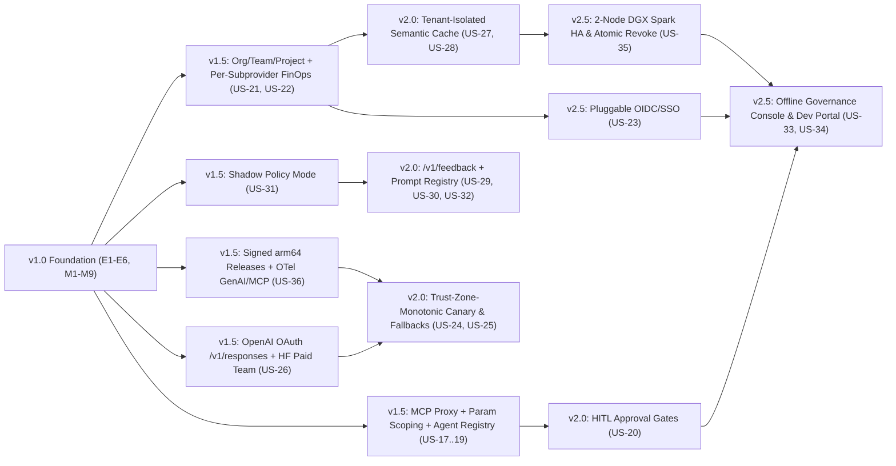

# Product Roadmap, RICE Prioritization & Delivery Playbook

> **Purpose:** Prioritize the capabilities extracted in [FEATURE_EXTRACTION_AND_GAP_ANALYSIS.md](FEATURE_EXTRACTION_AND_GAP_ANALYSIS.md) and defined in [PLATFORM_PRD_V2.md](PLATFORM_PRD_V2.md) into a sequenced, risk-managed delivery roadmap (`v1.0` → `v1.5` → `v2.0` → `v2.5`), complete with an internal enterprise adoption playbook, KPI tree, and product risk register.

---

## 1. RICE Prioritization Model & Scoring Matrix

Each candidate initiative is scored using **RICE**:
* **Reach (R):** Estimated percentage of internal teams/workloads impacted per quarter (`1`–`10` scale, where `10` = `100%` of gateway traffic).
* **Impact (I):** Customer/security/FinOps value (`3.0` = Massive, `2.0` = High, `1.0` = Medium, `0.5` = Low).
* **Confidence (C):** Evidence strength from competitor validation and technical spec clarity (`100%`, `80%`, `60%`).
* **Effort (E):** Engineering person-weeks (including offline test suite, docs, and security audit).
* **Formula:** `RICE Score = (R * I * C) / E`

| Rank | Initiative / Feature Cluster | User Stories | Reach (1–10) | Impact | Confidence | Effort (wks) | RICE Score | Target Release |
| :-: | :--- | :--- | :---: | :---: | :---: | :---: | :---: | :---: |
| **1** | **Signed `linux/arm64` Air-Gap Releases, OTel `gen_ai.*`/`mcp.*` & Queue-Wait** | `US-36` | 10 | 2.0 | 100% | 1.5 | **13.33** | `v1.5` |
| **2** | **OpenAI Enterprise OAuth (`/v1/responses`) & HF Paid Team Adapter** | `US-26` | 10 | 3.0 | 95% | 2.5 | **11.40** | `v1.5` |
| **3** | **Shadow Policy Mode (Zero-Disruption Tuning)** | `US-31` | 8 | 2.0 | 100% | 1.5 | **10.67** | `v1.5` |
| **4** | **Org/Team/Project Hierarchy & Per-Subprovider FinOps** | `US-21`, `US-22` | 9 | 2.0 | 100% | 2.0 | **9.00** | `v1.5` |
| **5** | **Governed MCP Proxy, Param Scoping & Pre/Post DLP** | `US-17`, `US-18` | 8 | 3.0 | 90% | 3.0 | **7.20** | `v1.5` |
| **6** | **Non-Human Agent Registry & Scoped Credentials** | `US-19` | 7 | 2.5 | 90% | 2.5 | **6.30** | `v1.5` |
| **7** | **Trust-Zone-Monotonic Canary Splits & Fallback Chains** | `US-24`, `US-25` | 8 | 2.0 | 90% | 2.5 | **5.76** | `v2.0` |
| **8** | **Zero-Leak `/v1/feedback` & Guardrail Analytics** | `US-32` | 7 | 1.5 | 90% | 2.0 | **4.73** | `v2.0` |
| **9** | **DLP-Exclusive Exact & Local Semantic Cache (Spark Node 2)** | `US-27`, `US-28` | 7 | 2.0 | 80% | 3.0 | **3.73** | `v2.0` |
| **10** | **Versioned Prompt Registry & Policy Decorators** | `US-29`, `US-30` | 6 | 2.0 | 80% | 3.0 | **3.20** | `v2.0` |
| **11** | **HITL Approval Gates for Risky Agent Actions** | `US-20` | 5 | 2.5 | 80% | 3.5 | **2.86** | `v2.0` |
| **12** | **Dual-Mode 2-Node DGX Spark HA (Postgres + Valkey) & Atomic Revoke** | `US-35` | 6 | 2.0 | 85% | 4.0 | **2.55** | `v2.5` |
| **13** | **Offline Governance Console & Developer Catalog UI** | `US-33`, `US-34` | 9 | 2.0 | 80% | 6.0 | **2.40** | `v2.5` |
| **14** | **Pluggable Local OIDC / SAML SSO & Delegated Admin** | `US-23` | 7 | 1.5 | 80% | 4.0 | **2.10** | `v2.5` |

> **Sequencing Insight:** Because our **15+ internal users** primarily demand **large Hugging Face Paid Team compute** (`router.huggingface.co` Inference Providers) and **OpenAI Enterprise OAuth (`/v1/responses`)** hosted on **2× NVIDIA DGX Spark (`linux/arm64`)**, `US-26` is promoted to **Rank #2 (`v1.5`)** right alongside signed `linux/arm64` releases, shadow policy tuning, multi-tenant + per-subprovider FinOps, and governed MCP + Agent Registry.

---

## 2. Phased Release Roadmap (`v1.0` → `v2.5`)

| Release | Theme | Included Epics / Stories | Key Exit Gate (Definition of Done) |
| :--- | :--- | :--- | :--- |
| **v1.0 Foundation** *(Existing Spec `M1`–`M9`)* | **Zero-Leak Core Gateway** | `E1`–`E6` (`US-01`–`US-16`) | All 8 offline test suites pass; `< 10 ms` p95 DLP; `0` bytes raw Tier-1/PII egress; `ruff` + `mypy` clean. |
| **v1.5 Governed Agent & Multi-Tenant Core** | **Unlock OpenAI OAuth, HF Team Compute & Agents** | `E7` (`US-17`, `US-18`, `US-19`), `E8` (`US-21`, `US-22`), `E9` (`US-26`), `E12` (`US-31`), `E14` (`US-36`) | OpenAI Enterprise OAuth (`/v1/responses`) & HF Paid Team (ZDR-pinned Inference Providers via `router.huggingface.co`) live on `linux/arm64` DGX Spark; `/v1/mcp/*` proxy `< 15 ms`; Org/Team budgets + per-subprovider spend attribution; Shadow Mode + signed/SBOM release + OTel `gen_ai.*`/`mcp.*`. |
| **v2.0 Intelligent Routing, Caching & Prompts** | **Optimize Cost, Latency & Prompt Discipline** | `E9` (`US-24`, `US-25`), `E10` (`US-27`–`US-28`), `E11` (`US-29`–`US-30`), `E7` (`US-20`), `E12` (`US-32`) | Trust-zone monotonicity verified (`local` never fails over externally); semantic cache on Spark Node 2 `< 5 ms` hit with `100%` DLP-exclusion pass; HITL approval queue + `/v1/feedback` + prompt registry operational. |
| **v2.5 Self-Service Console & Enterprise HA** | **2-Node DGX Spark Active-Active HA & Self-Service** | `E13` (`US-33`–`US-34`), `E8` (`US-23`), `E14` (`US-35`) | Single-origin zero-CDN Governance Console & Dev Portal live; OIDC/SSO role mapping; 2-node DGX Spark Postgres + Valkey HA over ConnectX-7 passes `<= 1s` atomic revocation and concurrent audit-chain stress tests. |

### Release Dependency Graph

---

## 3. Enterprise Rollout & Adoption Playbook

To prevent developer friction or shadow-AI bypass inside our **15+ user organization** hosted on **2× NVIDIA DGX Spark**, rollout proceeds across four gated stages:

| Stage | Target Audience & Infra | Gateway Posture | Explicit Exit Criteria to Advance |
| :--- | :--- | :--- | :--- |
| **Stage 1: Shadow & Baseline** *(Weeks 1–2)* | 3–5 pilot users on **DGX Spark Node 1** (`v1.0` + `v1.5` Shadow + OpenAI OAuth / HF Team) | DLP/Guardrails in `shadow` / `warn` mode (hard Tier-1 `SECRET`/`CLASSIFICATION` blocks + personal BYOS OAuth block active); local `7B–8B` Judge warm on Node 1. | • False-positive rate on proprietary code & org terms `< 2%`. • `100%` chunk-safe SSE restore across `/v1/responses` and HF streams. • `gateway_asgi_queue_wait_seconds` p99 `< 5 ms`. |
| **Stage 2: Full Team FinOps & HF Governance** *(Weeks 3–4)* | All **15+ internal users** across Team projects (`v1.5`) | Enforce `PSEUDONYMIZE` + `REROUTE_LOCAL` to **DGX Spark Node 2** (`32B–70B` local model); activate Org/Team budgets (`80%` alerts) + ZDR sub-provider allowlist (`:auto`/`:fastest` blocked) + per-subprovider spend tracking. | • `100%` of 15+ users mapped to Cost Centers / HF Resource Groups. • Mean `/v1/feedback` triage SLA `< 48 hrs`. • Zero raw PII/secrets/OAuth tokens in audit/OTel verification. |
| **Stage 3: Enforced Agents, Cache & Routing** *(Weeks 5–8)* | AI Agent workflows & production services on **2× DGX Spark** (`v2.0`) | Mandatory Agent Registry tokens (`gw_agent_*`); `/v1/mcp/*` parameter constraints; HITL gates; local embedding semantic cache on Node 2; canary + fallback chains. | • `100%` of production MCP tools routed via `/v1/mcp/*`. • Cache hit rate `>= 15%` on eligible safe HF/OpenAI workloads. • Zero trust-zone downgrade defects in chaos tests. |
| **Stage 4: Self-Service Portal & 2-Node Active-Active HA** *(Weeks 9–12+)* | Org-wide scale on **2× DGX Spark ConnectX-7 HA** (`v2.5`) | Offline Governance Console + Developer Catalog open with OIDC/SSO; 2-node Postgres + Valkey HA active across Spark 1 & 2; direct vendor API keys & personal OAuth paths decommissioned. | • `>= 90%` of org LLM/MCP traffic routed via gateway. • `<= 1s` key revocation verified across both DGX Spark nodes. • Monthly automated `/admin/audit/verify` passes `100%`. |

---

## 4. KPI & Measurement Framework

### North Star Metric
**Protected Governed AI Interactions per Week** — Weekly count of LLM completions and MCP tool invocations passing through `secure-ai-gateway` with `100%` DLP inspection, valid tenant/agent attribution, and `0` unapproved raw Tier-1/PII egress leaks.

### Four Balanced Metric Pillars

| Pillar | KPI | Formula / Definition | Target | Telemetry Source | Escalation / Alert Threshold |
| :--- | :--- | :--- | :---: | :--- | :--- |
| **Security & Compliance** | **Zero-Leak Egress Integrity** | Raw Tier-1/PII bytes reaching external APIs or persistent audit/logs | `0 bytes` | `MockTransport` CI + `/admin/audit/verify` | Any non-zero finding = `SEV-1` release blocker |
| **Security & Compliance** | **Guardrail False-Positive Rate** | `false_positive` feedback reports / total warned or blocked requests | `< 2.0%` | `/v1/feedback` + `gateway_guardrail_triggers_total` | `> 5.0%` triggers mandatory rule tuning in Shadow Mode |
| **FinOps & Cost** | **Effective Cost Avoidance** | `(Local Reroute Savings + Cache Hit Savings) / Gross Frontier Spend` | `>= 25%` | `gateway_cache_saved_usd_total` + `gateway_tokens_total` | `< 10%` prompts auto-router / cache threshold review |
| **FinOps & Cost** | **Budget Forecast Accuracy** | `%` of teams hitting hard caps unexpectedly vs. resolving via `80%` soft alert | `< 5%` surprise cutoffs | Budget webhook log + quota ledger | `> 15%` surprise cutoffs triggers FinOps onboarding review |
| **Reliability & Perf** | **Gateway Overhead (p95)** | `DLP + Policy + Cache/MCP overhead` excluding upstream TTFT | `< 10 ms` (LLM), `< 15 ms` (MCP) | `gateway_sanitization_duration_seconds` + `queue_wait` | `> 20 ms` p95 triggers worker scaling / regex audit |
| **Adoption & DX** | **Self-Service Onboarding Time** | Median time from OIDC login to first successful governed API/MCP call | `< 5 mins` | Console telemetry + catalog usage | `> 15 mins` flags UX friction in Developer Portal |

---

## 5. Product & Delivery Risk Register

| ID | Risk Description | Likelihood | Impact | Owner | Concrete Mitigation Strategy |
| :-: | :--- | :---: | :---: | :--- | :--- |
| **PR-01** | **Semantic Cache Cross-Tenant or PII Leakage:** A cached response containing restored PII or tenant-specific context is served to another user/role. | Medium | **Critical** | Security / Architecture Lead | Enforce **Invariant #14**: key namespaces include `(org_id, team_id, role_id, model, policy_version_hash)`, and any request with Tier-1/2/3 findings or `TokenVault` tokens bypasses cache read & write completely. |
| **PR-02** | **Developer Shadow-AI Bypass:** Strict DLP blocks or noisy guardrails frustrate engineers, causing them to obtain direct vendor API keys. | High | High | PM / Security Officer | Ship **Shadow Policy Mode (`US-31`)** before blocking, preserve **RAM `TokenVault` restore (`US-05`)** so frontier models stay useful, and provide `< 5 min` self-service keys + `/v1/feedback`. |
| **PR-03** | **HITL Approval Latency Stalls Agent Workflows:** Agents hang or time out waiting on human reviewers for risky MCP actions. | Medium | Medium | PM / Agent Platform Lead | Use async HTTP `202 Accepted` with `approval_id` polling/callbacks (`US-20`), configurable TTLs, Team Lead delegation, and narrow HITL triggers strictly to irreversible/privileged mutations. |
| **PR-04** | **MCP Protocol & Transport Churn:** Rapid upstream changes to MCP JSON-RPC / Streamable HTTP specs break gateway tool proxying. | High | Medium | Platform Tech Lead | Pin supported `mcp.protocol.version` contracts behind a versioned adapter layer and validate against offline mocked MCP server test harnesses. |
| **PR-05** | **Scope Creep from Governance Console UI (`E13`):** Frontend build complexity or external npm/CDN dependencies compromise air-gapped simplicity. | Medium | High | PM / Frontend Lead | Keep UI strictly single-origin, static-bundled with zero external CDNs, gated to `v2.5`, and built strictly over `/admin/*` & `/v1/catalog` APIs. |
| **PR-06** | **Supply-Chain Compromise (LiteLLM Lesson):** Compromised PyPI transitive dependencies or unpinned Docker tags introduce credential stealers. | Medium | **Critical** | SRE / Release Security | Enforce **Invariant #16**: hash-pinned `uv.lock`, minimal dependency tree (no heavy ORMs), offline `cosign` image verification, SPDX SBOMs, and zero-internet CI verification. |
| **PR-07** | **HA Storage Split-Brain / Revocation Lag:** Multi-replica deployments allow revoked keys or fork the audit hash chain. | Medium | High | Platform SRE | Use Postgres advisory locks for serialized audit chain writes and Valkey pub/sub with **fail-secure fallback** to direct DB lookup on disconnect (`<= 1s` revocation SLO). |
| **PR-08** | **Guardrail Judge GPU Contention:** Local judge (`80–500 ms`) creates tail latency spikes under concurrent org-wide load. | Medium | Medium | SRE / ML Infra | Bound judge timeout (`<= 1500 ms`), run fast heuristics first (`< 2 ms`), pin warm `7B–8B` judge on DGX Spark Node 1, skip judge on cached hits, and support `fail_open_with_warning`. |
| **PR-09** | **Personal BYOS OpenAI OAuth / ZDR Bypass:** Users authenticate with personal ChatGPT Pro/Plus OAuth tokens lacking enterprise ZDR or violating OpenAI intermediary ToS. | High | **Critical** | Security / Auth Lead | Enforce corporate OpenAI org/tenant ID pinning (`US-26`), block consumer OAuth tenants (`403 personal_oauth_prohibited`), and never persist OAuth tokens. |
| **PR-10** | **HF Inference Providers Sub-Provider Retention Drift & Unvetted Routing:** `router.huggingface.co` dynamically routes via `:auto`, `:fastest`, or `:cheapest` to third-party partners lacking ZDR guarantees. | High | **Critical** | Security / Platform Lead | Enforce explicit ZDR-approved `:provider` allowlists, block unvetted `:auto`/`:fastest`/`:cheapest` routing (`US-26`), treat all HF Inference Providers as `trust_zone == "external"` (full DLP + RAM `TokenVault`), and audit traffic/spend by `hf_subprovider` (`US-22`). |
