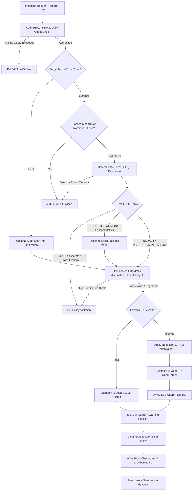
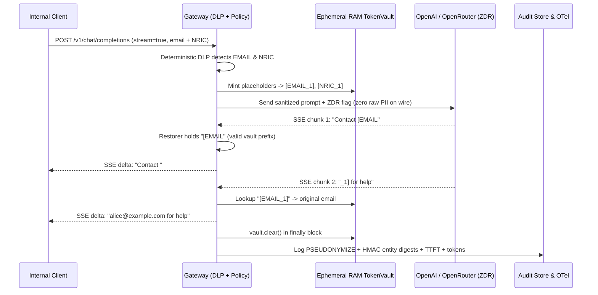
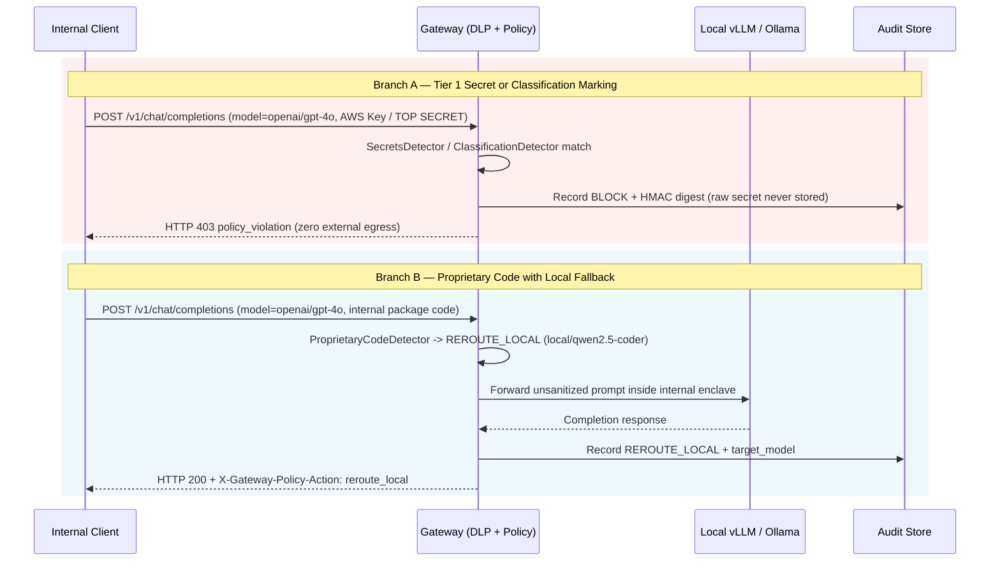
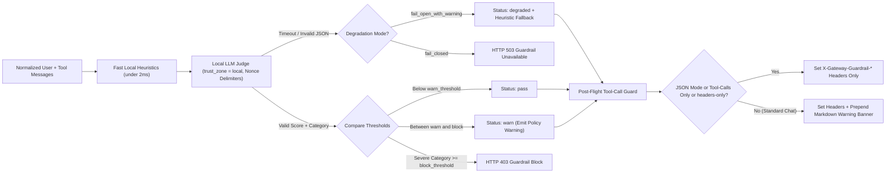
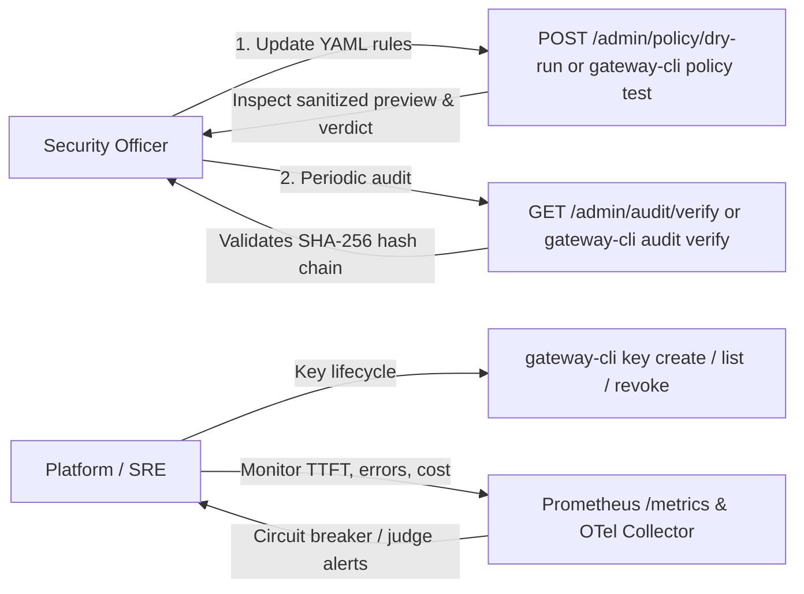

# Visual Workflows

## 1. End-to-End Request Decision Flow

Every incoming `/v1/chat/completions` and `/v1/embeddings` call follows a deterministic security-first pipeline before touching external providers, while running opinionated behavioral guardrails across both local and external traffic.

---

## 2. Reversible PII Pseudonymization & Chunk-Split SSE Restoration

When external models receive Tier-3 PII or internal host identifiers, mappings exist **only in single-request RAM**. Even when upstream LLM tokenizers split placeholders across SSE frames (e.g., `"[EMAIL"` followed by `"_1]"`), the streaming state machine buffers only candidate prefixes and emits restored text cleanly.

---

## 3. Tier-1 Hard Block vs. Local Auto-Reroute

Tier-1 secrets and classification banners fail fast before calling any upstream provider or burning GPU time on the local guardrail judge. Proprietary code transparently reroutes to a local coding model unless the caller explicitly disables fallbacks.

---

## 4. Opinionated Non-Deterministic Guardrail Pipeline

Because policy violations are often behavioral (e.g., asking an AI to encode internal data to evade DLP, run unauthorized security scans, or draft unapproved legal/HR notices), local heuristics and a **local-only LLM-as-a-Judge** score intent and emit client-safe warnings without disrupting valid JSON or tool-call automation.

---

## 5. Security & Maintainer Operational Loops

Operators manage keys, tune DLP/guardrail rules offline via dry-run, monitor real-time telemetry, and verify ledger integrity without accessing raw employee prompts.

